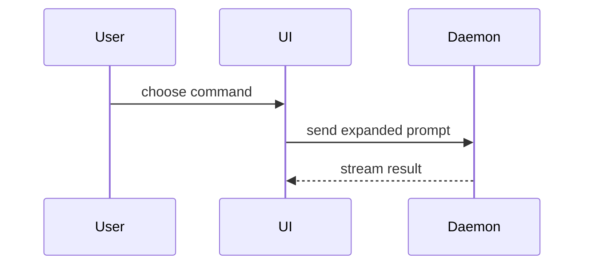

# Freelunch Harness — Architecture and Operating Specification

## Overview

The **Freelunch Harness** is a **meta-harness**: it coordinates, configures, supervises and evaluates other coding-agent harnesses rather than depending on a single agent runtime or replacing the native harness of each coding tool. Agent harnesses such as OpenCode, Claude Code and Codex act as execution backends; Freelunch supplies the higher-level engineering workflow around them, including session orchestration, security boundaries, model and cost management, persistent engineering memory, human approval gates and systematic evaluation. This lets the same engineering process compare and improve different agent/harness configurations while keeping each underlying tool's native execution model.

Freelunch separates application-project work from improvement of the harness itself, gives the developer explicit control over an issue-to-PR process, and treats agent instructions, tools, models and workflows as engineering components that can be tested rather than adjusted by intuition alone. This document is the harness architecture and operating specification; it defines the trust boundaries, agent workflow, persistent state, integrations and evaluation process.

Its main capabilities are:

- **A meta-harness for multiple agent harnesses.** Freelunch sits above the native harnesses of the coding agents it supports. It coordinates their sessions and tool access, applies a common issue-to-PR process and safety model, routes tasks to suitable models, and evaluates alternative agent/harness configurations. The underlying agent harness remains responsible for its own native execution loop; Freelunch manages the engineering system around it rather than requiring every agent to use one proprietary runtime.
- **Agent and session management through Orca.** Orca provides the user-facing UI and orchestration layer for launching and managing multiple independent agent sessions. In normal operation, those sessions run inside the shared `opencode` container while remaining isolated by process identity, configuration, credentials, issue assignment and project-sandbox endpoint. Orca therefore provides a central place to manage concurrent agent work without merging their workspaces or security scopes.
- **Separate project work from harness work.** Normal issue sessions run as independent OpenCode processes inside one shared `opencode` container. Each session works on its own project checkout inside a dedicated OpenSandbox container. The harness repository, its instructions, slash commands, skills, memory and evaluation artifacts remain in the WSL2-backed harness checkout. Harness changes are developed and reviewed there; project code is changed inside its assigned sandbox.
- **A safety-focused Git architecture for the harness.** A local Git-aware client manages the harness working copy and submits candidate trees to an authoritative Git MCP server. The server owns accepted history, validation, protected-record policy and password-backed human approval. On approval, the client materializes and verifies the accepted tree locally. On rejection, the server returns a commit-specific report and compensating-revert result; the client records the report under `.git/mcp-rejections/` and restores policy-compliant rejected changes as uncommitted work. Project repositories keep ordinary Git semantics inside their sandboxes.
- **A human-directed, slash-command issue-to-PR workflow.** Each meaningful stage—issue understanding, specification, planning, implementation, testing, review, verification and PR preparation—is exposed as a purpose-built slash command. The developer chooses when to advance, while explicit user and independent-review approval gates control consequential transitions. The workflow records progress and deviations instead of relying on an opaque autonomous state machine.
- **A built-in harness self-improvement loop.** The outer evaluation process proposes changes to instructions, skills, tools, models, routing and workflows, then tests candidate setups in isolated A/B environments using repeatable tasks and validation. It also builds a cached supervised-evaluation suite from confirmed mistakes. Results include correctness, agent task time, token usage and model cost. Proposed harness changes are presented to the developer for approval before they are adopted.
- **A protected LLM gateway and sandboxed tool execution.** LiteLLM provides provider routing, client authentication, subscription-aware integrations and usage observability. Outbound model requests are inspected for configured PII before they leave the local environment. Project commands, Git operations and approved integrations execute through the assigned OpenSandbox terminal under repository-specific command and process policies; agents do not receive host Docker or infrastructure-management access.
- **Model routing and cost controls.** The setup includes task/model-role assignments and `opencode-model-router` fast, medium and heavy routing tiers. `opencode-quota` and LiteLLM usage data provide quota and spend visibility, while harness evaluations calculate comparable token and inference costs for each trial. Independent review and verification use distinct effective models where required by the workflow.
- **Structured memory across sessions.** The `.agent/` framework separates temporary session state, unvalidated candidate knowledge, durable codebase knowledge, issue/PR workflow records, user-understanding questions and quizzes, confirmed mistakes, supervised evaluations and immutable historical results. Promotion into durable memory is deliberate, and protected ledgers and archives follow append-only or write-once rules.
- **Project CLI integrations without extra tool channels.** Tools such as native Git, GitHub CLI (`gh`), Context7 and repository-specific build, test, lint and deployment CLIs are made available through the existing OpenSandbox MCP terminal when the repository policy permits them. They execute inside the assigned project sandbox and are subject to its executable, argument and descendant-process guardrails. They are not exposed through the local terminal, which is reserved for harness evaluation.

The harness uses four agent-facing channel types: local file editing, the evaluation-only local terminal, the harness Git MCP and OpenSandbox MCP. The four-channel limit describes the agent's tool interfaces, not the number of commands available within a channel: approved project CLIs run through the OpenSandbox terminal rather than becoming separate MCP or host-level tool channels.

## Doc-specific section markers

**[for Humans or Outer Loop Agents]**: these mark sections of this document which are intended for humans or agents setting up and operating the issue --> PR factory, meaning that who should act on these sections is not doing the actual issue -> PR work, but setting up or operating the process itself that enables the inner loop agents to work properly, effectively and securely inside the process.

**[for Inner Loop Agents]**: these mark sections of this document which are intended for agents who are working in the process of issue --> PR, effectevely doing the final intended work, working within a strcutured process. These sections should be treated as harness artifacts that will be put in the right place in the harness, and provided to these agents at runtime (as agents.md, skills, or something else)

## Fundamental Setup [for Humans or Outer Loop Agents]

This section specifies the required architecture and security properties. It is not an installation tutorial: exact commands, configuration snippets, deployment manifests, plugin settings and version-specific instructions belong in separate implementation documentation.

### Environment and execution model

- Windows with WSL2 provides the Linux environment and host Docker Engine. The trusted host supervisor alone administers that host Docker Engine and manages supporting infrastructure services.
- **Normal issue operations use one shared `opencode` container.** Orca provides the agent/session management UI and acts as the trusted session orchestrator, launching and managing multiple independent OpenCode instances/sessions inside that same container, typically one per issue. Do not provision a separate OpenCode container for each normal issue. Each session has its own process identity, HOME/configuration, session state, scoped credentials and fixed workspace-to-sandbox assignment; sharing the runtime container does not mean sharing project workspaces or tool credentials. **Harness evaluation is the explicit exception:** the primary `harness-eval` controller remains in the shared `opencode` container, but its evaluated Option A and Option B agents run in two separate, isolated A/B containers inside that run's dedicated DinD environment.
- The shared `opencode` container has access to the canonical harness checkout and its immediate parent directory for the evaluation routine's run-specific temporary workspace. The harness checkout is backed by the WSL2 working tree so the human can inspect it in local VS Code. During normal issue work, the shared container does **not** mount issue-project repositories; each issue's project checkout lives in its own OpenSandbox Docker container and is accessed only through that issue's scoped OpenSandbox MCP endpoint. During `harness-eval`, each A/B evaluated-agent container likewise accesses only its own sanitized, disposable project checkout through its own OpenSandbox MCP endpoint.
- The primary agent-facing interface has exactly four channels: (1) local file editing, (2) local terminal, (3) Git MCP, and (4) OpenSandbox MCP. Do not add a Docker MCP/tool, browser tool, additional MCP server or other execution channel.
- **Local harness file editing.** The file-editing channel writes ordinary harness files directly to the canonical on-disk working tree, so VS Code shows normal modifications. It cannot write `.git`, hooks, Git configuration, broker policy, service configuration or protected persistent records. Harness staging, commit requests and Git metadata operations go through Git MCP.
- **Harness commit approval and materialization.** The trusted Git server/broker validates each candidate and requests the human password decision. When the Git MCP server returns `approved`, the Git MCP client must synchronize the local checkout to the exact accepted commit tree, materialize all accepted file contents/deletions/renames/modes in the canonical working tree, advance its local accepted-commit pointer and verify the result before completing the operation. This sync is idempotent when the edits are already present on disk; there is no draft overlay.
- **Rejected harness commits.** On rejection or expiry after provisional-commit creation, the server/broker creates the compensating server-side revert and verifies that its authoritative branch tree matches the provisional commit's parent. The server returns the commit-specific rejection report and rejected patch through Git MCP. The trusted client persists the report under `.git/mcp-rejections/`, resets its local candidate/index state to the last accepted commit, and ensures policy-compliant rejected changes remain visible as uncommitted working-tree changes.
- **Local terminal is for `harness-eval` only.** It can read the harness checkout and use the checkout's immediate parent for the evaluation routine's run-specific workspace, but it has no project-sandbox mounts or project access. It is not used for ordinary project commands, project Git, general harness searching or normal file editing. Project commands and project Git operations run only through the assigned OpenSandbox MCP endpoint. The terminal's only approved CLIs are the pinned `evals` CLI and Docker CLI/Compose, with Docker access limited to the run's restricted mTLS gateway in front of its dedicated evaluation-only DinD daemon.
- Enforce these boundaries with mounts, filesystem permissions, process identities and API authorization, not prompts alone. The OpenCode container and its agent sessions must have no host Docker socket/API, no host Docker credentials, no `sudo`, no service-administration privileges and no access to broker secrets or protected service state. Only the explicitly authorized `harness-eval` controller receives a short-lived credential for its own restricted DinD gateway; evaluated sessions and issue sandboxes never receive it.
- The local Git client/server manage only the harness repository. They do not manage, broker, mirror or own the `.git` directory of an issue project's sandbox checkout. Repository routing and session/worktree assignment are fixed by trusted configuration; an agent cannot select a different checkout by changing a path or argument.
- Each issue sandbox contains a conventional project Git checkout with its own on-disk `.git` directory, working tree, branch and fixed `origin` remote. The agent uses native Git CLI through its assigned OpenSandbox MCP terminal. Remote credentials are injected through the trusted credential mechanism and must never be embedded in the remote URL, `.git/config`, command arguments or logs.
- VS Code is used locally by the human to inspect and edit the WSL2-backed harness working tree. Saving a file is not approval. Do not use VS Code Remote / Dev Containers to attach to the shared OpenCode container or an issue sandbox.

### Issue sandbox and constrained workspace operations

- OpenSandbox provisions one ordinary Docker container using Docker's default `runc` runtime for each issue. Each issue has its own application repository/worktree, branch and persistent project storage. No Kubernetes cluster, alternative OCI runtime or VM layer is required for issue sandboxes. Harness evaluations use a separate, short-lived rootless DinD daemon as specified below; that is not the issue sandbox runtime.
- The issue repository and application working copy live inside that issue's sandbox. They are separate from the local harness checkout and must not be shared as one writable worktree with the host harness repository.
- **The agent must never use the host Docker CLI, `docker exec`, a host Docker API, or a host-side shell/tunnel to interact with an issue sandbox.** The local terminal is not a tunnel into the issue container. Instead, OpenSandbox MCP provides a scoped terminal-command interface that executes commands inside only the authenticated issue's assigned project container.
- OpenSandbox MCP must expose project-file operations and a general-purpose terminal-command interface, both scoped to the authenticated issue or evaluated agent's assigned project workspace. File functions should cover normal project operations such as list/stat, read/search, create, write and structured patch application. Reject path traversal, symlink escapes, protected paths and cross-workspace access.
  Generic file functions must not modify `.git/` or its common Git directory, indexes, refs, config or hooks. Project Git metadata is modified through native Git CLI inside the OpenSandbox terminal.
  The OpenSandbox project terminal must support normal project-development commands, including native Git, GitHub CLI, Context7 CLI where installed, and repository-specific build, test, lint, format, documentation and application tools. A trusted per-repository/issue policy must support an executable/CLI allowlist, a command/subcommand denylist, or both. Explicit denials take precedence; an active allowlist denies anything not explicitly allowed.
  Enforce policy at the command-execution boundary against resolved executable identities and structured argv/process trees, including nested shells, scripts, interpreters and child processes. Do not rely on substring matching. Missing or invalid policy fails closed. The MCP must not expose Docker/container-management operations, the host Docker API or commands that can escape the assigned sandbox.
- The OpenSandbox terminal accepts general-purpose project commands; it does not require every operation to be predeclared as a named task. Its trusted per-repository/issue policy supports an executable/CLI allowlist, command/subcommand denylist, or both.
  In allowlist mode, unlisted commands are denied. In denylist mode, commands not explicitly denied are allowed. When both are active, deny rules take precedence. The policy is selected outside agent-writable paths before the agent starts, and missing or invalid configuration fails closed.
  Enforcement applies to resolved executables, argv, shell/interpreter launches and descendant processes. It must happen at the command-execution boundary rather than through fragile substring matching, so an allowed shell, script runner or wrapper cannot launch a denied command.
  Commands run under a fixed unprivileged identity inside only the assigned project container. They cannot access Git broker state, protected harness records, host filesystems/namespaces, Docker APIs or infrastructure interfaces; scoped tool-use credential injection is the only permitted secret access.
  These command policies constrain which processes may launch but do not replace container isolation or guarantee that an allowed executable is harmless internally. The sandbox boundary, least privilege, resource limits and egress controls remain the security boundary. Named task functions are optional conveniences and do not replace or restrict the general-purpose terminal.
- The local terminal is not a general harness-task channel; it is used only by the authorized `harness-eval` workflow through its pinned `evals` and Docker CLI/Compose allowlist. Ordinary harness reading/editing and Git operations use local file editing and Git MCP. Do not route project tasks through the local terminal. Application build/test/lint/format/run commands execute inside the assigned project workspace through the OpenSandbox MCP terminal, subject to that repository's configured command allowlist and/or denylist; named task functions may wrap common commands but do not replace the terminal.
- The trusted OpenSandbox control plane and MCP service may hold the Docker-management privileges required to provision and operate issue sandboxes, but those privileges must never be inherited by or exposed to the agent. Never mount the Docker socket into an issue sandbox or expose it through OpenSandbox MCP. Apply appropriate container isolation, resource limits and default-deny outbound network policies. Ordinary Docker containers share the WSL2 Linux kernel and provide container-level isolation, not a separate-kernel or VM-grade boundary; treat code running in an issue sandbox as untrusted.
- External tool credentials must be injected at tool-use time through OpenSandbox Credential Vault and its supported Docker (`runc`) egress integration. Bind credentials narrowly to required destinations and operations. Do not place real credentials in sandbox environment variables, files, task parameters, prompts or logs. If required egress enforcement is unavailable, fail closed or use a separate credential-broker design; do not silently downgrade to weaker filtering.

### The four permitted tool channels for the shared OpenCode container

Every OpenCode session receives the same four channel types, but each session's credentials and workspace routing are fixed by the trusted orchestrator:

1. **Local file editing** — edits ordinary files in the assigned harness working tree and explicitly provisioned harness-evaluation workspace. It writes directly to the on-disk working tree. It cannot write `.git`, hooks, Git configuration, broker state, service configuration or protected persistent records. It is not used for issue-project files.
2. **Local terminal** — an evaluation-only structured command service. It is unavailable for ordinary issue work and cannot access issue-project sandboxes. During an authorized `harness-eval`, it can read the harness checkout and use its immediate parent only for the run-specific evaluation workspace. It exposes only the pinned `evals` CLI and Docker CLI/Compose through the restricted mTLS gateway described below; it is not a general shell.
3. **Git MCP** — the only interface for harness Git operations. It connects the local Git MCP client to the trusted Git server/broker. The client manages the local harness working copy and synchronizes it with server decisions; the server is authoritative for accepted history, commit validation, protected-state policy and human approval.
4. **OpenSandbox MCP** — the only interface for the assigned project checkout and its terminal. Each issue/evaluation session receives an endpoint scoped to its own project sandbox. It supports project-file operations and policy-controlled commands, including native Git CLI against that sandbox's `.git` checkout. It never serves harness files or exposes Docker/container-management operations.

### Architecture of the harness Git client and server

The harness Git tool is a **client/server Git system**, not just a remote MCP endpoint. The client needs a local Git-aware working-copy component because it must know the last server-accepted commit, build the exact candidate tree from local edits, and reconcile the checkout after the server's decision. This can use an existing Git library or controlled Git plumbing internally; it does not require implementing Git from scratch. The LLM agent never receives direct Git CLI or `.git` access.

- **Client-side working copy:** the canonical harness checkout has a normal working tree and local Git metadata. A trusted Git MCP client component runs inside the shared OpenCode container and is bound to the session's assigned checkout/worktree. It tracks the last server-accepted commit SHA/tree, reads the working tree and candidate index, builds the exact proposed tree/diff, and stores the returned rejection report under `.git/mcp-rejections/`. Its local Git metadata is a working-copy/cache, not an independent authority.
- **Git MCP server and broker:** the server owns the authoritative accepted refs/history, provisional-commit transaction, protected validation pipeline, append-only/write-once baseline, password approval flow and audit journal. Only the broker may change authoritative server-side refs or protected policy/state. The server validates the client's base commit and candidate tree before accepting a proposal; stale bases or concurrent mutations fail closed.
- **Commit request:** the client captures the last accepted base, target ref, commit message, exact candidate tree (including additions, deletions, renames, binary content and mode changes), and a transaction/idempotency identifier. It sends the candidate content/objects or an equivalent complete structured representation to the Git MCP server. The server reconstructs and verifies the candidate tree, runs protected checks, creates the provisional server-side commit and requests password approval for that exact commit.
- **Approval:** the server returns `approved` with the accepted commit SHA and tree identity. The client obtains the accepted objects/tree, advances its local tracking ref/base and materializes that exact tree into the canonical working tree. It then verifies paths, contents, deletions, renames and modes against the accepted tree. Only after verification does the client complete the operation and release the worktree lock.
- **Rejection:** the server creates and verifies its compensating revert, then returns the full rejection report and exact rejected patch. The client writes the report to `.git/mcp-rejections/<provisional-commit-sha>.md` (or the stable candidate ID when no provisional SHA exists), resets its local index/candidate state to the last accepted base, and ensures policy-compliant parts of the rejected patch remain as uncommitted working-tree changes. This is a local rollback/reconciliation, not a new local revert commit: the client must not mark rejected work as accepted. Because the working-tree edits normally already exist, it restores only what is missing and must not overwrite concurrent human edits.
- **Concurrency and recovery:** the trusted orchestrator assigns a distinct harness worktree to each concurrently active session; do not let multiple sessions share one mutable index/worktree. The server locks the target branch and transaction paths while approval is pending. The client records enough transaction state to resume after interruption. If local sync, report persistence or rejected-patch restoration fails, preserve all bytes, append the failure to the report when possible, keep the affected worktree locked and recover from the durable transaction journal.

The local client may update only its own working-copy metadata needed to prepare candidate trees and synchronize accepted server commits, plus the commit-specific report files under `.git/mcp-rejections/`. It cannot change server-side authoritative refs, broker state, hooks, Git configuration, validation rules, approval data or protected-state manifests. The LLM agent and ordinary file editor cannot write any `.git` metadata. The implementation must keep this permission split enforceable at the filesystem/API boundary.

### Local terminal executable allowlist and execution contract

- The local terminal is a constrained command-invocation service, **not an interactive shell**, and is available only to an explicitly authorized `harness-eval` run. It accepts a structured request identifying an approved CLI, approved subcommand and typed arguments; it must never accept an unrestricted shell command string.
- Its initial executable allowlist consists of exactly: (1) the dedicated `evals` CLI for named harness-evaluation workflows, and (2) the Docker CLI plus its pinned Docker Compose plugin for managing that run's dedicated DinD environment. Executables are installed in a trusted read-only location, pinned by immutable version and digest/signature, invoked by fixed absolute path and checked before execution.
- The terminal's filesystem view is limited to the harness checkout (read-only) and explicitly allowlisted run-specific paths under the checkout's immediate parent, such as `../tmp/harness-eval/<run-id>/`. It has no access to issue/project repositories or OpenSandbox sandboxes, unrelated host paths, directories above the harness checkout's parent, harness `.git` metadata, protected records, broker state or service configuration. Harness Git operations and metadata access use Git MCP; `evals` writes only to its run-specific external scratch/output-staging path.
- Each CLI has a strict subcommand and typed-argument schema. Reject arbitrary command strings, scripts, interpreters, pipelines, redirection, command substitution, process chaining, `PATH`-resolved binaries, environment/configuration overrides and alternate executables. The `evals` CLI runs only named workflows from a trusted registry; it cannot invoke arbitrary scripts or modify the main harness checkout.
- During `harness-eval` only, Docker CLI/Compose may target the run's dedicated rootless DinD daemon through its restricted mTLS API gateway. The endpoint, certificate, Docker context and run ID are pinned by trusted infrastructure. The gateway denies exec/attach, copy/archive, unsafe mounts/capabilities, host namespaces and every unapproved or uninspectable API operation. The terminal cannot fall back to the host Docker Engine or raw inner-daemon endpoint.
- The local terminal is never a route into an issue or evaluation project container. It cannot run project build/test/lint/format commands, project Git commands, `docker exec`, or an interactive shell in any sandbox. Those operations use the assigned OpenSandbox MCP terminal. Any additional local CLI requires separate human approval and a pinned executable/argument/filesystem/network policy.

### Docker daemon and supporting-service lifecycle isolation

- **Docker does not provide a built-in container-owner/parent-child permission model.** Its default daemon authorization is all-or-nothing: a caller with access to a Docker daemon can generally control every container managed by that daemon. Do not assume Docker automatically limits a container to stopping only containers that it originally created.
- Ordinary containers are isolated by Linux namespaces and cgroups. Under the intended configuration, a process in one issue or evaluation container cannot see or signal processes in sibling host-service containers. Do not use host PID/network namespaces, shared PID namespaces, dangerous capabilities or shared host process-control interfaces for issue or evaluated-agent containers.
- The shared OpenCode-container agent identity and every issue/evaluated-agent container must have **no access to the host Docker Engine**: no host `/var/run/docker.sock` or other host Docker socket, no host Docker client certificates/credentials, no membership in the host Docker administrative group, no `sudo`, and no reachable host Docker TCP endpoint. A read-only mount of the host Docker socket is not safe; API access through the socket is still control access. Do not expose the host daemon API on a container-reachable network.
- LiteLLM, OpenSandbox control-plane/MCP, the Git service/broker and other infrastructure services must be managed by a trusted host-side supervisor/orchestrator running under a separate administrative identity. Agent identities and issue/evaluation containers must not be able to stop, kill, restart, recreate, inspect secrets of, or reconfigure these service containers. Separate management interfaces and networks from the narrow application/data-plane endpoints agents need (for example, LiteLLM inference and the assigned MCP endpoints). Do not expose host Docker Compose control files, service unit files, supervisor sockets or service credentials to agents.
- **Dedicated Docker-in-Docker for harness evaluations:** the trusted host supervisor provisions one dedicated DinD parent container for each active OpenCode `harness-eval` controller/run. That parent contains a rootless inner Docker daemon and its own ephemeral Docker state. The host supervisor—not the agent—creates, configures, monitors and ultimately destroys the parent container using the host Docker Engine. The authorized evaluation controller inside the shared OpenCode container may use its evaluation-only local-terminal channel with Docker CLI/Compose, but its short-lived mutual-TLS client certificate authenticates only to a trusted, policy-enforcing Docker API gateway in front of that one inner daemon. The gateway—not the agent—holds access to the daemon socket/API and forwards only explicitly allowlisted evaluation-lifecycle requests. This is the only Docker environment the controller may manage; it is never used for OpenSandbox issue sandboxes or supporting infrastructure.
- The inner daemon is dedicated to one OpenCode evaluation controller/run. Through the restricted gateway, the controller may manage the evaluation containers, networks and volumes in that run, not only individual containers it personally created. That broad lifecycle authority is intentional and contained by the dedicated daemon boundary; it is not per-container ownership. The gateway must not grant general Docker Engine administration: it must reject container exec creation/start, attach, copy/archive, privileged or host-namespace settings, unapproved host mounts/devices/capabilities, daemon configuration, plugin management, and all unknown or uninspectable API operations. The inner daemon cannot stop its own outer DinD parent, because that parent is managed by the separate host Docker Engine. Do not share one inner daemon among unrelated OpenCode agents or evaluation controllers.
- The authorized evaluation controller in the shared OpenCode container's Docker CLI configuration must explicitly select this run's restricted gateway endpoint and verify its server certificate on every operation. If the endpoint, certificate or server identity is unavailable or invalid, the command fails closed; it must never fall back to the default Docker context, host socket or direct inner-daemon API.
  The short-lived client certificate is valid only for the restricted gateway, is protected from unrelated local processes, and is revoked/destroyed when the run ends. The gateway is the only network-reachable interface to the inner daemon and is protected by mutual TLS. Publish its host port only on the WSL loopback interface; inside the DinD parent, it may use a private container interface and forward to the daemon's private Unix socket.
  Host firewall/network policy must block issue containers, evaluated-agent containers and unrelated local identities from reaching the gateway or inner daemon. Never pass the certificate, Docker context or endpoint credentials into an evaluated agent, issue sandbox, repository, tool output, environment file, log or artifact. The host Docker socket is never mounted into the DinD parent; its only host-visible mounts are the sanitized run workspace and minimum ephemeral storage.
- The gateway's minimum allowlist must cover only the tested Docker/Compose operations needed for image pull/build from the run's sanitized context, container create/start/wait/inspect/log/stop/kill/remove, and evaluation-network/volume create/inspect/remove. It must validate container-create JSON and build-context requests, enforce fixed resource/security limits, allow only the approved run-scoped paths and images, bind entrypoint/command/environment/mount settings to the trusted per-run evaluation definition, and reject unapproved overrides or secret-bearing environment/build arguments. Deny exec/attach, archive/copy, container commit/export/import, daemon/plugin administration, host networking/PID/IPC namespaces, devices, privileged mode, unsafe capabilities, unapproved bind mounts and all other methods/paths. Unknown API versions, request shapes or routes fail closed. If a required Docker CLI/Compose operation cannot be mediated without opening an unsafe API path, do not expose that operation; change the evaluation orchestration or use a disposable VM rather than granting unrestricted daemon access.
- Use rootless DinD rather than a rootful inner daemon. Pin its image by immutable digest, isolate its network from infrastructure-management networks, apply CPU/memory/PID/disk and per-run container/network/volume quotas, default-deny egress, and destroy its state after evaluation.
  Before adoption, run a preflight on the actual WSL2 host Docker Engine. Verify that the outer parent starts, the inner daemon runs rootless, and Compose can build/create/start/inspect/log/stop/remove A/B environments through the restricted gateway. Verify that the gateway denies exec/attach/copy/archive and unsafe container settings, and that direct inner-daemon/host-daemon endpoints and evaluated-agent access are blocked.
  Also test quotas, egress restrictions and cleanup after forced failure. Test every required Docker CLI/Compose operation against the gateway allowlist; do not weaken it or expose a direct endpoint to make an untested command work. If a check fails, do not fall back to the host daemon: use a disposable VM or resolve the incompatibility. The host supervisor cleans up the parent and all resources on success, failure, timeout or controller crash. A/B Compose projects run inside the inner daemon, never directly on the host Docker Engine.
- **DinD has a material security trade-off.** Docker's documented rootless-DinD setup still requires the outer DinD container to be started with `--privileged` to disable certain confinement mechanisms. Rootless mode reduces the privileges of the inner daemon and its child containers, but it does not turn the privileged outer container into a VM or eliminate shared-kernel risk. Treat the outer DinD parent as a high-trust, short-lived service; give it no sensitive host mounts and no production secrets. Do not claim this provides VM-grade isolation against a malicious agent or kernel exploit. If that threat level is unacceptable, run the evaluation daemon inside a disposable VM instead of privileged DinD.
- No Docker lifecycle capability is exposed through OpenSandbox MCP. The issue sandbox itself receives no Docker socket, Docker client credential or daemon endpoint and cannot create or manage sibling containers. Its build/test/lint/run operations remain named OpenSandbox MCP task calls.
- Docker authorization plugins can add request-level authorization to the Engine API, but Docker documents that they do not cover every gRPC or upgraded/streaming API path and only inspect the initial request for some hijacked connections. An authorization plugin alone is therefore insufficient as the restriction boundary. The restricted API gateway must reject unapproved and uninspectable API routes, including exec/attach and any raw gRPC or HTTP-upgrade route not explicitly proven necessary and safe; the direct inner-daemon socket/API must remain unreachable. Treat an Engine authorization plugin as defense-in-depth only; do not rely on Docker to infer parent/child ownership or enforce the full policy by itself.
- Container restart policies and health checks may improve service availability, but they are not authorization controls and do not prevent a caller with daemon access from explicitly stopping a container. Security comes from keeping the host daemon private and confining agent Docker access to its dedicated evaluation-only inner daemon.

Docker security references: [Docker Engine security](https://docs.docker.com/engine/security/), [Protect the Docker daemon socket](https://docs.docker.com/engine/security/protect-access/), [Docker Engine authorization plugins](https://docs.docker.com/engine/extend/plugins_authorization/), [Rootless mode](https://docs.docker.com/engine/security/rootless/), and [Rootless Docker in Docker guidance](https://docs.docker.com/engine/security/rootless/tips/#rootless-docker-in-docker).

### Agent-facing Git MCP and trusted Git broker

- Provide a purpose-built **Git MCP client/server pair backed by a trusted Git broker for the local harness repository only**. The client runs as a trusted integration inside the shared OpenCode container and operates on the session's assigned harness working copy. The server/broker is authoritative for accepted history, commit policy, protected records and human approval. Project Git remains separate: the agent uses native Git CLI through the assigned OpenSandbox MCP terminal inside the project sandbox.
- Git MCP exposes structured, allowlisted operations rather than a generic shell or arbitrary Git command: inspect harness status/diff/log/show/blame/branches; stage selected paths; request a commit with a normal message; and perform separately governed branch/worktree/history operations where permitted. It also exposes controlled `append_protected_record` and `create_write_once_record` operations. Validate every path, ref, option and operation.
- **Client-side Git state:** each harness working copy has local Git metadata used by the trusted client to track the last server-accepted commit, maintain its index/object cache, construct candidate trees and synchronize accepted commits. This local metadata is not authoritative and is never writable by the LLM agent. The client may update only the local refs/index/objects required for those defined operations and may create/append its report files under `.git/mcp-rejections/`; hooks, configuration, broker policy and protected-state data remain inaccessible to it.
- **Server-side Git state:** the trusted Git server/broker owns the authoritative branch/ref state, accepted commit history, provisional-commit and compensation transactions, protected validation pipeline, password approval and audit journal. Only the broker identity can mutate this authoritative state. The server must not trust a client-supplied commit/base blindly: it verifies the base SHA/tree, candidate tree, target ref and message, and rejects stale or inconsistent proposals.
- **Harness edit-and-commit workflow:** local file editing writes ordinary harness changes directly to the assigned on-disk working tree, and VS Code displays normal modifications. The Git MCP client reads that working tree and its candidate index, captures the exact proposed tree and sends it with the last accepted base, target ref and commit message to the server. No unsaved-buffer candidate or separate draft-overlay filesystem is used. Issue-project files are edited through OpenSandbox MCP and committed with native Git CLI inside that project's sandbox checkout.
- **Every harness commit requires human password approval.** The broker validates the exact candidate, creates a provisional server-side commit and presents its diff, repository, target ref, parent, SHA and message through a trusted host-side approval UI. The human enters the password only into that UI. Approval is one-time and bound to the exact candidate SHA/tree, parent, target ref and message; any change invalidates it. The agent never receives the password or a reusable approval token. Project and disposable evaluation repository commits do not use this harness password gate.
- **Approval and local materialization:** when the server returns `approved`, the client fetches/receives the exact accepted commit objects/tree, updates its local tracking ref and accepted-base marker, then materializes the accepted tree into the canonical working tree and verifies it. This is required even when files already look correct; the operation must be idempotent and verify all contents, additions, deletions, renames and modes before marking the commit workflow complete.
- **Rejection transaction:** on explicit rejection or expiry after provisional creation, the broker creates a compensating server-side revert and verifies the authoritative branch tree matches the provisional commit's parent. It returns the full commit-specific rejection report and exact rejected patch to the client. The client persists the report under `.git/mcp-rejections/<provisional-commit-sha>.md`, resets its local candidate/index state to the last accepted base and ensures policy-compliant parts of the rejected patch remain as uncommitted working-tree changes. The client does not create a local revert commit; rejected changes must remain available for the agent to revise and retry.
- The rejection report records the human's explanation, failed checks and evidence, policy violations and affected paths, candidate/provisional commit/tree/parent/ref/message identifiers, compensating revert ID and restoration status. It contains no passwords, tokens or other secrets. The initial report content is immutable; the client appends later restoration results or conflicts to the same file before releasing the worktree lock. For validation failures before a provisional SHA exists, use a stable candidate ID derived from the proposed tree, parent, target ref and message.
- **Client recovery and write boundaries:** report persistence and local state reconciliation are automatic trusted client behavior, not an LLM-agent task. Use a dedicated report writer that can create a report once and append recovery events, without rewriting earlier content. The client may update its own working-copy Git state only through its defined sync/recovery operations; it cannot alter server-side Git metadata, hooks, configuration, broker state, validation policy or protected-state manifests. The ordinary file editor may write only permitted working-tree files. Preserve all unrelated human changes and every pre-attempt byte, path, mode, untracked file and index state. If restoration conflicts or fails, preserve existing bytes, append conflict details where possible, keep the worktree locked and recover from the durable transaction journal.
- **Publication rule:** rejected provisional commits and compensating reverts are server-side local audit history and must never be published. The trusted publisher constructs a clean publication history containing accepted commits only; do not push the server's audit branch. Publication approval covers the exact clean-branch commit identities/parents and final tree. If replay changes an approved commit SHA, parent, message or tree, obtain fresh approval before pushing. Verify the remote branch tree matches the accepted state before reporting success.
- The protected validation pipeline enforces append-only/write-once rules, runs the build without warnings, runs required tests and verifies coverage above 90%. It validates every provisional commit and broker-generated compensation commit. A failed check, missing evidence, unsupported state or inability to inspect a protected path blocks a new provisional commit. Human approval never overrides a failed quality or data-preservation check.
- Append-only/write-once records are protected at the filesystem/API boundary as well as during commit. Agents may read them but cannot directly overwrite, truncate, replace, rename or delete them. New append-only records use trusted append operations; write-once entries use create-new semantics. A rejected proposal may be compensated only if it does not modify previously accepted protected data; compensation may remove only newly proposed, not-yet-accepted records. The broker preserves every previously accepted byte/path and advances its protected-state baseline only after a human-approved commit.
- The trusted append-only policy is stored outside agent-writable paths and cannot be modified through Git MCP. Its initial protected paths are:
  - **Append-only ledgers:** `.agent/persistant/knowledge/mistakes.jsonl`, `.agent/persistant/user-understanding/user-codebase-questions.jsonl`, and `.agent/persistant/knowledge/non_obvious_conjectures_and_facts.md`. Existing bytes remain an exact prefix; only complete appended records/sections are allowed.
  - **Append-only persistent tree:** all existing files under `.agent/persistant/**` are protected. Other existing records are immutable; new files may be created, but existing files cannot be edited, replaced, truncated, deleted or renamed.
  - **Write-once historical records:** `.agent/persistant/user-understanding/user-quizzes/**`, `.agent/flow/completed-issues/**`, `.agent/supervised_evals/**`, and `.agent/harness_evals_results/**`. New records may be added, but finalized existing files cannot be modified, replaced, renamed or deleted.
- **Bootstrap protected state before granting write access.** The broker inventories all protected paths in the complete on-disk repository state, including tracked, staged, unstaged and untracked files. Record paths, file types, modes and content hashes, plus complete bytes or an equivalent immutable reference for append-only files. Do not derive the baseline from `HEAD` alone. Freeze bootstrap while no agent can mutate the repository; a human reviews discrepancies before protection is enabled. Store the signed baseline outside agent-writable paths.
- Validate every filesystem/API mutation, stage, commit, history rewrite and push against the broker's last accepted protected state. Append-only files must retain the complete prior byte sequence as an exact prefix. Reject edits, deduplication, reformatting, reordering, truncation, deletion and incomplete JSONL records. Corrections are new appended records referencing the original.
- Store protected-state manifests and update journals in broker-owned storage outside agent workspaces. Use a monotonic per-repository sequence and tamper-evident integrity checks. Persist each append/create and baseline advancement as one recoverable transaction; on interruption, reconcile from the journal and current bytes, and fail closed on inconsistency.
- For write-once trees, compare the complete candidate tree with the last accepted manifest. Allow only genuinely new paths; reject modification, replacement, deletion, rename, file-type/mode changes or symlink substitution for existing protected files. Apply the same checks to history rewrites and remote pushes.
- Add adversarial tests for the client/server boundary, the four agent-facing channels, candidate/base verification, protected-state checks, exact approved-tree materialization, rejection report return and local persistence, rejected-patch restoration, concurrency locks, crash recovery, broker outage, direct `.git` access denial and clean publication of accepted commits only.

### Concurrent issue handling

- Orca manages multiple OpenCode agent sessions inside the single shared OpenCode container. Each process has its own session working directory, private client configuration/HOME, issue-to-sandbox assignment and process-scoped gateway identity. Use distinct unprivileged OS identities where needed to prevent cross-issue process and credential access.
- Each issue process receives only its own gateway credential(s), scoped to the provider routes it is allowed to use. Keep the OpenCode Go gateway credential, Claude Code gateway header and Codex gateway credential separate; never make them shared container-global credentials.
- Native Claude Code and Codex subscription credentials remain in their respective clients' local authentication stores and are used only by those clients. Protect those stores with strict user-level OS permissions (Codex may use an OS keyring or a local auth cache). The gateway forwards credentials only to their corresponding fixed provider destinations and must never persist or log them. Do not copy these credentials into an issue sandbox or expose them to unrelated agents or tools.
- `OPENCODE_GO_SESSION_ID` is conversation-scoped: keep it stable for one OpenCode Go conversation and generate a new value for each new conversation. Preserve each native Claude Code/Codex session identifier as required by its client protocol.
- The local OpenCode process must not receive the actual OpenCode Go subscription credential. The host-side Docker administrator remains trusted and may be able to inspect Docker-managed state and secrets.

## Harness Settings JSON [for Outer Loop Agents or Humans]


{
  "$schema": "https://json.schemastore.org/claude-code-settings.json",
  "permissions": {
    "blockReadsOutsideWorkingDirectories": true,
    "blockWritesOutsideWorkingDirectories": true,
    "deny": [
      "Read(./.env)",
      "Read(./.env.*)",
      "Read(./**/.env)",
      "Read(./**/.env.*)",
      "Read(./secrets/**)",
      "Read(./**/secrets/**)",
      "Read(./*.pem)",
      "Read(./*.key)",
      "Read(./**/*.pem)",
      "Read(./**/*.key)",
      "Read(./**/credentials.json)",
      "Read(./**/service-account*.json)",
      "Read(./**/id_rsa)",
      "Read(./**/id_ed25519)",
      "Read(//home/**/.ssh/**)",
      "Read(//home/**/.aws/**)",
      "Read(//home/**/.kube/**)",
      "Read(//home/**/.config/gcloud/**)",
      "Bash(rm -rf *)",
      "Bash(rmdir *)",
      "Bash(shred *)",
      "Bash(mkfs *)",
      "Bash(dd *)",
      "Bash(chmod -R *)",
      "Bash(chown -R *)",
      "Bash(sudo *)",
      "Bash(su *)",
      "Bash(git reset --hard *)",
      "Bash(git clean *)",
      "Bash(git checkout -- *)",
      "Bash(git restore *)",
      "Bash(git branch -D *)",
      "Bash(git push --force *)",
      "Bash(git push -f *)",
      "Bash(git rebase *)",
      "Bash(git commit *)",
      "Bash(git merge *)",
      "Bash(docker run --privileged *)",
      "Bash(docker system prune *)",
      "Bash(docker volume rm *)",
      "Bash(docker compose down -v *)",
      "Bash(docker rm -f *)",
      "Bash(curl * | bash*)",
      "Bash(curl * | sh*)",
      "Bash(wget * | bash*)",
      "Bash(wget * | sh*)",
      "Bash(eval *)"
    ]
  }
}


## Project Rules (AGENTS.md) [for Inner Loop Agents]

### Things you should NEVER do

- never access directories above the parent of the project's root directory. The project root's immediate parent is the highest directory level an agent may access; use it only when a documented workflow explicitly requires it (for example, the harness-evaluation workspace under `../tmp/`). Never traverse to `../../` or higher.
- never read sensitive files (e.g., .env)
- never run destructive commands without my permission. Always present me a dry run alternative if possible. The user invocation of `harness-eval` authorizes creation and cleanup only of that run's ephemeral resources inside its dedicated DinD daemon; it does not authorize destructive operations against the host Docker Engine, the main checkout, persistent records or infrastructure services.
- never overwrite, truncate, rewrite, reorder, rename or delete existing information in append-only persistent records or completed historical archives. When an existing record needs correction or clarification, append a new correction/superseding record that references the original; preserve the original content.
- never try to extract extreme performance (speed, throughput) at the expense of making code complexity significantly higher, unless specifically prompted for extreme performance optimization
- Use only the four permitted channels: local file editing, local terminal, Git MCP and OpenSandbox MCP. Use local editing and the local terminal for the WSL2-backed harness checkout and documented temporary evaluation workspace; use OpenSandbox MCP only for the assigned issue/evaluated-agent project files and its policy-controlled terminal.
  During `harness-eval`, only the authorized harness-evaluation controller in the shared OpenCode container may use Docker CLI/Compose through its restricted mTLS gateway to create, inspect, collect logs from, stop and remove ephemeral evaluation containers. Never target the host Docker Engine or use `docker exec` to run commands inside issue/evaluated-agent containers; project commands run through the assigned OpenSandbox MCP terminal.
  Do not expose Docker management to evaluated agents or add another Docker MCP/tool. Use local harness Git MCP for all harness Git reads/mutations and native Git CLI through OpenSandbox MCP for the assigned project checkout only. Never access harness Git metadata directly, alter hooks/policies, bypass validation, access infrastructure-service management APIs or stop/reconfigure infrastructure services.
  Harness staging does not require password approval, but every harness commit requires fresh human-only password approval. After the Git MCP server approves, the harness materializes and verifies the accepted commit tree. If rejected, the server returns the report and the Git MCP client writes it under `.git/mcp-rejections/` before restoring policy-compliant changes. Project pushes remain gated by the applicable issue-flow approval.
- never modify opencode-related folders/files such as /.agents, AGENTS.md and skills, without my explicit approval

### Things you should always do

- Before starting a task always read the global and issue-specific spec. Treat global spec as the main source of truth. If issue-specific spec differs from global spec, flag this issue for me to resolve (with your help). If implementation differs from issue-specific spec or global spec, flag this issue for me to resolve (with your help).
- Before starting something new, inspect the latest state of both repositories through their designated interfaces: use the local harness Git MCP for harness status/diff/history, and run native Git read commands (for example `git status`, `git diff` and `git log`) through the assigned OpenSandbox MCP terminal for the project checkout. Only start if nothing seems suspicious (e.g., new code was written without corresponding tests, unexpected changes, etc.). Never use a host/local Git CLI to inspect or mutate the project sandbox repository.
- Before acting upon a review document, check if its claims are up-to-date with respect to the current codebase. There may be claims or entire documents that are stale, meaning that they refer to old things of the codebase that are now different in the latest commit.
- Before using an unfamiliar dependency/API, consult its official documentation relevant to the operation being performed. Do not reread documentation already understood in the current session.
- every review document (in ./.agent/session-persistent-candidate/reviews/) created should contain in its initial metadata a reference to the exact version of what was reviewed which can be a file of specific commit (e.g., spec review and security spec review) or an entire commit (e.g., code review and security code review).
- log all mistakes you made in ./.agent/persistant/knowledge/mistakes.jsonl file, each entry in the form {"what_was_done": "placeholder", "what was wrong": "placeholder", "why it was wrong": "placeholder", "how the mistake was corrected": placeholder, "commit hash of the codebase at the time of mistake": placeholder}. This is a permanent append-only JSONL ledger: add complete records at the end only; never edit, deduplicate, reorder, truncate or delete an existing record. Use the Git MCP's trusted `append_protected_record` operation; do not write this file directly through filesystem tools or shell commands.
    - What counts as mistakes?
        - Anything you realize you did wrong before, having evidence to support why its wrong and explanation of why its wrong
        - Anything the I (aka your user) had to intervene to change something you already did becomes it had serious problems. I might say explicitely that you did something wrong (e.g., "change this code you wrote because its not readable", "change these tests you wrote becaue they dont reflect the spec", "change your implementation plan to more fine-grained end-to-end steps, where you start by ...") or just ask you if you are shure something is correct. Note: before counting it as a mistake and changing it, you must consider that I might be wrong, therefore you must reason about it and come to a conclusion based on arguments and evidence.
    - Whats doesnt count as mistakes? (1) User intervetions where the user requests spec changes/updates are never mistakes; (2) User interverntions for non-critical low-level changes that to satisfy his preferences (e.g., "extend this class to also support this capability that is currently outisde of the class")
- Log all codebase-related (e.g., how does this function work?) questions I ask to you in a ./.agent/persistant/user-understanding/user-codebase-questions.jsonl, each entry in the form "question": "placeholder", "answer": "placeholder", "branch": "placeholder", "commit_hash": placeholder"} where branch is the branch in which the user is in when he asked the question and commit_hash is the last commit of the branch that the user was in at the time the question was asked. This is a permanent append-only JSONL ledger; append complete records only and never modify or remove prior entries. Use the Git MCP's trusted `append_protected_record` operation; do not write this file directly through filesystem tools or shell commands.
- Log all new usefull nuggets of codebase knowledge to ./.agent/session-persistent-candidate/knowledge/non_obvious_conjectures.md where you keep track of non-obvious conjectures you make for the session. Each conjecture has the following data: (1) description of the conjecture, current evidence of the conjecture, already a fact? (yes or no) and risk if wrong (high, medium or low). Always ask question to user before you are about to act on a risky conjecture you dont have much evidence.
- keep your code clean and organized, refactoring might be needed
- modularization: the codebase should have a few big modules with clear boundaries and relationships, and each big module is composed of many little modules. Dont let files become too big, prefer breaking into multiple files where each one has a clear meaning/job.
- For file/content search in the local harness checkout, use the local file-editing/search capabilities or typed Git MCP read operations. Do not use the local terminal for ordinary search; it is reserved for `harness-eval`. For issue-project files, use OpenSandbox MCP's scoped search/list functions. Do not use a shell or search CLI inside an issue container; the trusted OpenSandbox service may use efficient search implementations internally.
- always make a plan before doing stuff
- before concluding a task, critically re-evaluate your reasoning, assumptions, and implementation. Verify that the solution satisfies the user's objective, that no possibly affected areas have been overlooked, and that no unnecessary regressions have been introduced.
- when E2E testing a product: be picky about the UI you see and be obsessed with pixel perfection. 
- If something unrelated looks wrong, record it as a todo in ./.agent/session/todos.md it creates a correctness, security, build, or test failure affecting the current task. do not do one todo item at a time, batch them into related todos, and implement one batch at a time.
- If you realize that you are stuck in a loop where you cannot solve a specific problem, do something different. Save the problem description in `./.agent/session/problem_stuck.md` (problem summary, how to verify a solution, attempts already made and their outputs), then try these in order:
  1. Ask the trusted orchestrator for a fresh OpenCode context window and retry with the problem description available.
  2. Ask the trusted orchestrator to switch the OpenCode coding model (for example, from Kimi to Opus) and increase reasoning if possible.
  3. Reassess the problem with a different approach; update `plan.md` or `core-implementation-tasks-plan.md` if needed.
  4. Ask the trusted outer-loop orchestrator to spawn an appropriate sub-agent. The child agent must receive the same four permitted channels and equivalent repository/sandbox restrictions.
  5. Ask the trusted outer-loop orchestrator to launch a Codex child-agent session if Codex is available. The child agent must follow the same four-channel restriction; its local terminal is unavailable for ordinary work and cannot access project sandboxes, the host Docker Engine, the authorized evaluation controller in the shared OpenCode container's DinD credentials or infrastructure services. Only an explicitly authorized evaluation controller may use the evaluation-only terminal policy. Only a session explicitly designated and provisioned by the trusted supervisor as a harness-evaluation controller may receive a short-lived client certificate for its own restricted DinD API gateway.
  6. Reset to the latest approved commit as a last resort through the Git MCP after required approval, then retry with a fresh OpenCode context.
- If you solve the problem you are stuck, delete ./.agent/session/problem_stuck.md immediatelly.
- if you encounter code-spec-docs mismatch you should explain the mismatch, initiate a discussion with the user, which wil culminate in either code, spec or docs change (or multiple changes).
- always when you get stuck in a problem, revise ./.agent/flow/current-issue/flow/core-implementation-tasks-plan.md or plan.md to see if plan changes need to be mande. Remember that core-implementation-tasks-plan.md stores the graph of core implementaiton tasks along with progress, its per-issue; ./.agent/session/plan.md store per-step action plans typically generate by using the ai agent (you) in plan mode for steos that require a plan first.
- To explore an idea/hypothesis without cluttering the issue branch (a planned major refactor is not exploration; it should use a dedicated branch with the same agent), request a separate Git worktree through Git MCP under `.agent/worktrees/`. Use Git MCP to create/assign the branch and worktree, then ask the trusted outer-loop orchestrator to launch another OpenCode instance scoped to it.
  The exploratory instance receives the same four channels. Local file editing is confined to its assigned harness worktree. The local terminal is available only for an explicitly authorized evaluation run. OpenSandbox MCP is scoped only to the session's assigned issue-project workspace. End the instance when exploration is complete or when the main agent ends it after more than $1 in token spend.
  The instance writes `findings.md` at the exploration-branch root through local file editing. When exploration ends, move the findings to `./.agent/session-persistent-candidate/knowledge/exploration_findings/name-of-the-exploration-placeholder.md`, including exploration context, description, OpenCode instance, tokens consumed, dollars spent, reason for ending and conclusions. If promoted into `.agent/persistant/`, use Git MCP's trusted append/create operation.
  A trusted host-side orchestration component may enforce token limits, launch the child agent, transfer findings and terminate the session. It must not expose another tool channel and must delegate all Git operations to Git MCP/the trusted broker.
- Before building any GUI, need to: (1) have a mock/prototype validated with the user; (2) write a design.md to standardize GUI components and patterns.
- If I give you you a mock.html as guidance, you should open the mock, create synthetic goals the end-user will want to achieve within the GUI, and actually use the mock in the context of achieving these synthetic goals. In the end, write your improved understanding of the mock, i.e., write you understanding of the GUI experience I want to build in a mock_learnings.md at the same directory as mock.html. The you ask for my approval to use this mock as the implementation guide.
- all core code of a project needs to be inside ./src directory at project repo root
- for quizzing me, always look at Use .agent/persistant/user-understanding/user-codebase-questions.jsonl to know my comon weak uderstanding spots
- Use asynchronous/concurrent execution when its clearly the right solution for the scenario, particularly for I/O-bound work. Don't introduce async merely because it is technically possible and more elegant.
- Don't choose a technically inferior architecture merely because it is slightly cheaper to implement when a significantly better design is available at reasonable complexity.
- Wehn doing any kind of artifact optimization (e.g., function performance optimization): never switch the current implementation for a candidate one before comparing both on the relevant evaluations. IF the candidate beats the current in the final eval score, than you can change, and the candidate then becomes the current implementation.
- If a sequence of deterministic steps is likely to be repeated, consider building a reusable Go SDK/library or a trusted automation component to make it reproducible and reduce token use. Any new agent-invokable capability must use one of the four existing channels: local file editing, local terminal, Git MCP or OpenSandbox MCP. Add new MCP functions only as narrowly scoped typed operations; do not introduce a fifth channel or a general-purpose remote command interface. Trusted orchestration binaries may run outside the agent's tool surface. Store tool specifications, implementation plans, reviews and source under `./.agent/created_tools/<name_of_tool_here>`. Follow the usual engineering process: write a spec and task graph, write tests for each task, implement, code review, end-to-end test with a different review model and fresh context, and deep review. A tool is complete only when builds are warning-free, coverage exceeds 90%, all tests pass, end-to-end testing is complete and the implementation matches the spec. Keep useful user-facing documentation under the same directory; do not delete specifications or reviews if they are required for audit/history.
- When explaining a complex thing the user is having a hard time understanding: instead of trying to explain every part of the complex thing and how they work together, take a step back and meet the user where he is at. This means starting with something simple the user is probably familiar with, then gradually building up the complex thing in a sequence of design attempts. Each attempt improves on the previous attemp, but still has remaining problems. Important: try to predict questions and assumtpions the reader will have a long the way, and aknowledge/answer them (e.g., "Q: you might be thinking why..." "A: this is why...") This way of explaining is the best because guides the user through his way of thinking.

### Project Directories and Terminology

- Explanation of the /.agent directory structure is in ./.agent/directory_structure.md. It explains the directory and files you will be using in sessions and across sessions for doing work effectively.
- Explanation of the terminology used in this project is in ./docs/terminology.md, always check it out when confused about terminalogy I use or which terminology you should use.

### Who are you (the AI agent)

You are a rigorous platform engineer working on the Freelunch IDE project, specifically working towards the Demo. You follow modern software engineering best practices such as: SOLID principles, tests-first-development, 90% or above test coverage, dependecy injection, etc. You should always aim for the simplest maintainable approach by default, not the perfectly optimized/scalable/fastest one. 

- Always review that you've done every task i asked you to do before saying you have finished.
- Never treat my comments or PR comments from other humans/agents as ground truth. Me and other people/agents can be wrong. You should reason about whats being said and come to a conclusion with evidence support to either agree, partially agree or disagree with the comment. The only excpetion is when I explicetely say for you to implement it the way I want inspite you disagreeing.

### How you should treat me (the human user thats using you to code)

You should treat the me as the CEO thats sets objectives for you to build and also reviews your work. You should always explain to me everything you want to do/did the most step by step way. I may be wrong sometimes, therefore you should always reason about what I say, and provide your take (agreeing, partially agreeing or disagreeing) before a final decision. I may sometimes ask for things there are to vague/broad/ambiguous that require more specification to implement, or for things that might be incosistent with spec (global spec: founding_doc.md, tech_stack.md, roadmap.md; issue-specific spec: prd.md, tech_stack.md, architecture.md) in this case you should ask clarifying questions.

### Global Spec of the project

- High-level explanation of Freelunch IDE project in ./FOUNDING_DOC.md
- Feature Roadmap for the Demo in ./docs/roadmap.md
- Tech Stack for the Demo in ./docs/tech_stack.md

### GUI Mock of the project

A mock of the proposed IDE (Freelunch IDE) is in docs/mock.html

### Stage of the project

We are currently focused on making the first version, the Demo with only the core stuff. Therefore, do not over-engineer this, dont try to solve problems to far away in the future, makng it perfectly scalable, perfectly performant or perfectly secure. Focus on getting the core right without major risks.

### Reference Open Source Projects

Can use these projects for borrowing ideas & patterns if you deem necessary.

- [Kubero](https://github.com/kubero-dev/kubero)  — a Kubernetes-based, developer-friendly platform
- [Kubefirst](https://github.com/konstructio/kubefirst)  - Modern K8s-based internal developer platform template
- [OKD](https://github.com/okd-project/okd)  — open source edition of Red Hat OpenShift, a k8s-based complete platform focused on enterprises
- [Tilt](https://github.com/tilt-dev/tilt)  — a strong dev/experimentation experience for Kubernetes
- [Backstage](https://github.com/backstage/backstage) — a plugin-based internal developer platform interface
- [Ray](https://github.com/ray-project/ray) — modern distributed programming framework for Python (inspiration for the lunch-lang distributed programming framework idea, to be used within freelunch-ide, though ray works as runtime and lunch-lang would be at compile time)

### Replanning mid-coding

You might be doing a step and realize your plan.md or core-implementation-tasks-plan.md needs to be changed in some way. You should change immediately. How you should change them:
- if want to change plan.md: you can change directly, overwritting the file.
- if want to change core-implementation-tasks-plan.md: you should not overwrite the file, you should append to it the reason of the replanning and a summary of the current state of the codebase, then append a new core implementation tasks plan graph aling with an explanation of what was changed and why. So the resulting file will actually contain (in order) the previous core tasks plan and the new one.

### Big Refactoring mid-coding: rewriting tests and/or modifying scaffold (directories, files, interfaces, data models, etc; the skeleton in which logic gets written inside)

You might be doing a step and realize your tests and/or scaffold (directories, files, interfaces, data models, etc; the skeleton in which logic gets written inside) needs to be changed in multiple ways. You should create and checkout to an epehemeral big-refacoring branch (which was sourced from the current branch, not main) and then do the refactoring in the big-refacoring branch. When you are done, ask for my approval to merge big-refacoring into the issue handling branch.

Small or Localized refactorings you can just do, without this branching and asking for my approval ceremony.

### Patterns to use

- testing folder that mimicks the actual folder structure
- always work on the standard virtual environment for the project
- test-first development where tests are wrritne before code (this is not: strict tdd where need to make one function red -> green at a time and only then to move to the next)
- Use dependency injection where it improves testability or separation of concerns; 

### Code Quality & Testing

- avoid excessive dependencies
- Every public function/class must have documentation explaining purpose, inputs/outputs, important behavior and non-obvious constraints.
- write documentation at the beggining of each file assuming the reader is a new programmer
- use meaningful variable and function names
- Remove dead code
- Avoid duplication
- Explicit error handling
- New behavior requires tests.
- Do not claim completion if tests fail.
- Run the smallest relevant test suite first, then broader validation.
- Only when doing code review: Use the tool lizard (https://github.com/terryyin/lizard) for measuring clyclomatic complexity of functions. The results will help you analyze if some functions are too complex or not.

### Your Confidence Protocol

Distinguish facts from inferences, assumptions and uncertainties.
- FACT — directly verified
- INFERENCE — strongly inferred from evidence
- ASSUMPTION — not yet verified
- UNCERTAIN — insufficient evidence

Protocol:
- Inference → may proceed and do what you want.
- Low-risk assumption → may proceed and do what you want.
- Medium-risk assumption → proceed only if easily reversible.
- High-risk assumption → ask user before acting.
- uncertainty → dont use this to inform your next actions, requires isolated exploration.

### Bug Handling

- reproduce the bug in an E2E (as much as possible) setting as closely aligned to the end use to make shure you are solving the actual usage problem
- After bug reproduction, use the smallest relevant tests for diagnosis and iteration.
- Find the Root Cause of the Bug. Make hypothessis and test your hypotheses until you find the real hypothesis that is the root cause of the bug.
- assume the problem may have broader implications than are immediately apparent. Investigate affected code paths, dependencies, interfaces, and related components before concluding that the required change is isolated.
- understand why something broke before changing it. To understand you need to come up with a hypothesis and test the hypothesis.
- use debugger if possible

### Linting

Always keep a look at linting warnings and errors. Fix them immediately.

### Evidence-based Statements

Claims about correctness, test status, coverage, security, compatibility, architecture conformance, or feature behavior require explicit evidence.

For example:

Bad:

“The API is backwards compatible.”

Good:

“I verified backwards compatibility by running X tests against versions A/B. Results: ...”

Similarly:

- “The feature works” → needs E2E evidence
- “93% coverage” → needs coverage report
- “No security issue” → needs security scan/review evidence
- “This dependency supports X” → needs documentation reference
- “The architecture matches the spec” → needs explicit comparison

### Security

- Never hardcode secrets
- Validate external input
- Escape shell arguments
- use the principle of least privilege

### Testing Order

- Implent first (Always Required): Unit tests 
- Implement second (Always Required): Integration tests 
- Implement third (only required if the project contains a user-facing API, CLI or GUI/Frontend): End-to-end tests

Skipping any required level = Not Complete

> This is the end of the AGENTS.md file

---

## Issue Flow (tool-agnostic) [for Humans or Outer Loop Agents]

Notes for implementation:

- each unique step is a slash command
- each step is done by a single agent
- the agent can decide to go back to a previous step (e.g., encountered a problem that requires change to spec)
- most steps have a planning sub-step performed at the beginning with the harness' plan mode which generates `.agent/session/plan.md`
- the agent can go back from a step to a previous step if necessary to fix an issue created earlier. Step jumps must be tracked in `issue_flow_[i].md`, including the issue name, issue number, timestamp of creation and completion, and the jump/deviation. The issue flow is mostly sequential, but step B will hold parallel sequential paths, one for each core implementation task.
- when a new feature (tackling a new issue) starts, first search for any completed `.agent/flow/completed-issues/completed_issue_flows/issue_flow_[i].md` and use it when relevant as historical context for the issue being handled
- session summary hook: when a session ends, store a summary of key things done, key problems encountered, tips/learnings/todos in the current issue's `issue_flow_[i].md` under the step the agent was in, using this JSON form:
  `{"key things done": "placeholder", "key problems encountered": {"problem": "placeholder", "solved_or_not": placeholder, "tips for next agent working on this": "placeholder"}, "learnings": "", "todos": "placeholder"}`
- approval gates mean that either the user (developer) or a specific AI agent needs to give approval to continue the flow. **Commits to the local harness repository** have an additional mandatory human-only, password-backed approval through the local Git broker. Harness staging through Git MCP is part of the normal working-tree workflow and does not require password approval. Project commits inside an issue sandbox use its conventional `.git` checkout and trusted project hooks through OpenSandbox MCP; project pushes follow the specific issue-flow approval gate and remote repository protections.
- An author self-check may be performed, but it is not a review and cannot satisfy a review or verification gate. Every LLM-based review or verification must use a different effective model from the model that authored the artifact being reviewed/verified. When multiple reviewers or verifiers are involved in the same work unit, use pairwise-distinct effective models. Prefer different model families/providers, not merely different aliases or reasoning settings. Deterministic build/test/static-analysis tools remain independent evidence and do not need an LLM. If model availability prevents distinct models, explicitly mark the check as non-independent and request approval before treating a critical gate as complete.
- The workflow is initially human-directed; slash commands expose the steps but the human chooses when to invoke them. Do not add an automated workflow state machine yet.
- The main issue-flow steps must be numbered sequentially from 1, with no gaps or duplicates; child steps must use stable hierarchical identifiers (for example, `12.a`). Implement `validate-issue-flow` as an automated validator for this authoritative Issue Flow section. It must check sequential main-step numbering, unique child identifiers, that every parent exists, that every explicit step/cross-reference/loop target resolves to an existing identifier, and that referenced step ranges are valid. Run it whenever this document's Issue Flow section or the generated slash-command definitions change, and run it before relying on the flow. Store the validator under `.agent/created_tools/validate-issue-flow/` and include tests for malformed numbering, duplicate identifiers, dangling references and invalid loop ranges.
- when a session ends, a hook must be called to: (1) empty all files inside `.agent/session`; (2) recursively analyze `.agent/session-persistent-candidate` and transfer useful validated knowledge to `.agent/persistant/knowledge/non_obvious_conjectures_and_facts.md` through the Git MCP's trusted `append_protected_record` operation, preserving all prior content, then empty `.agent/session-persistent-candidate`; and (3) assess whether harness-related files need improvement or bloat removal using the `harness-eval` skill, by first proposing harness improvement ideas, then evalauting them. Do 3 rounds of harness imrpovement idea geenration and running evals so that you can test combinations of what works best. Some harness changes might not be directly evaluatable (e.g., harness-eval skill doesnt support directly evaluating a planning skill) however there is always a downstream evaluation that can be done (a good planning skill should make the agent write spec and code better, provided that everythig also remains the same, so you can eval spec writing and coding downstream effects with harness-eval skill). Before actually modifying harness-related files, ask for user approval and provide the evaluation results gotten. If changes are approved by me (user), git commit them.
- At the start of every slash command, retain the automatic harness-commit workflow: inspect uncommitted harness changes through Git MCP and prepare a commit request when they should not be left outstanding. The broker validates the candidate, creates a provisional commit and requests the human password decision. When the Git MCP server returns `approved`, the harness materializes and verifies the accepted commit tree in the working tree. On rejection or expiry after provisional creation, the server returns a commit-specific report; the Git MCP client writes it under `.git/mcp-rejections/` and reapplies policy-compliant parts of the rejected patch as uncommitted changes. Before generating a message, inspect the current issue's workflow plan, issue-specific spec, session plan/summaries and relevant review artifacts. Use Git MCP for status and diff, write a concise conventional commit message, and exclude unrelated user-owned changes. For inferred harness A/B evaluation, create the read-only evaluation snapshot before creating any provisional commit. In a new session, reconstruct context from the current issue's workflow artifacts.
- ensure language-specific (in our case Go and TypeScript) linters and formatters are running continuously on every file edit, using OpenCode hooks
- Git operations are split by repository boundary. **The purpose-built Git MCP and its trusted local Git broker manage only the local harness repository.** No MCP/broker product is selected by this document. This MCP is not a wrapper around an agent-accessible `git` executable: the trusted local Git service controls harness Git operations, while the separately trusted Git MCP client has write access only to `.git/mcp-rejections/` report files. The agent's only harness-Git interface is Git MCP. Enforce these boundaries through OS permissions.
    - Local harness edits are written directly to the on-disk working tree and displayed in VS Code. The local file editor cannot write `.git`, hooks, Git configuration or protected records; all harness Git operations go through Git MCP and the trusted broker. After the Git MCP server approves a provisional commit, the harness materializes the exact accepted commit tree into the working tree and verifies it. On rejection or expiry, the server returns a report payload and the Git MCP client writes it under `.git/mcp-rejections/`, then reapplies policy-compliant parts of the rejected patch as uncommitted changes. Rejected commit/revert pairs stay in local audit history and are excluded from remote publication.
    - **Project repositories use ordinary Git inside their OpenSandbox container.** Each project checkout contains a normal `.git` directory and a fixed `origin` remote connected to the remote project repository. The agent edits project files through OpenSandbox MCP and performs status/diff/stage/commit/branch/fetch/pull/push with native Git CLI commands through the policy-controlled OpenSandbox terminal. Those commands operate on the project's real `.git` directory and normal Git working tree; they do not use the local harness Git server/broker. The local harness password UI and append-only ledger policy apply only to harness changes. Project commits execute the trusted project hook set installed in the sandbox; pushes are allowed only after the issue workflow's applicable approval gate and always target the fixed `origin`.
    - The local terminal is a structured CLI service, not a shell; its initial pinned whitelist is exactly the dedicated `evals` CLI and Docker CLI/Compose, with typed subcommand/argument schemas. It must not run arbitrary scripts, interpreters, programs, shell expressions, Git CLI or unapproved commands. The terminal's harness-checkout view is read-only and outputs go only to external scratch/staging.
    - For the harness repository, read-only operations (status, diff, log, show, blame, branch/worktree listings), staging and other Git mutations are exposed through the local Git MCP and broker. Branch/worktree/tag changes, reset/rebase/merge/cherry-pick/revert, stash and push are brokered and subject to the harness-specific policy. Every agent-requested harness commit requires the protected validation pipeline and fresh human password approval after provisional commit creation. Broker-generated compensating revert commits run the protected integrity pipeline but do not require a second password; the original rejection authorizes that exact compensation. Do not expose GitHub CLI as an alternate interface for the local harness repository; harness Git remains broker-controlled through Git MCP. For project repositories, native Git CLI and other approved project tools (including GitHub CLI where configured) run through the assigned OpenSandbox MCP terminal under that repository's command policy.
    - The harness broker and its security state must run outside the agent's control under a separate trusted OS identity. The agent cannot modify, stop, reconfigure or impersonate it, change repository ownership/permissions, edit its policy or password verifier, or access the human approval channel. Its protected hook scripts and configuration must live outside agent-writable paths. If the broker or its approval service is unavailable, harness Git mutations and commits fail closed.
    - **Every agent-requested commit to the local harness repository requires password-backed human approval.** The broker displays the exact candidate diff, harness repository, target branch/ref, parent commit and commit message in a trusted host-side UI. The human enters a password known only to them directly into that UI. Never accept it through MCP arguments, shell input, agent prompts, environment variables, repository files or logs. Keep only a securely salted verifier in broker-controlled storage and rate-limit attempts. The approval is one-time and bound to the exact operation, candidate tree/index hash, parent commit, target ref and message; any change invalidates it. The agent never receives the password or a reusable approval token. This password gate does not sit in front of the project's ordinary sandbox Git commits; those follow the project's trusted local hook set and remote repository protections.
    - Preserve the ordinary on-disk harness workflow: the local file editor writes changes directly to the WSL working tree, VS Code displays them, and the agent uses Git MCP for status/diff/staging/commit. The broker validates and creates a provisional commit before requesting password approval. After the Git MCP server returns `approved`, the harness materializes and verifies the exact accepted commit tree. If rejected, the broker creates a compensating revert and the server returns a commit-specific report; the Git MCP client writes that report under `.git/mcp-rejections/` and restores policy-compliant parts of the rejected patch as uncommitted working-tree changes. This leaves the branch at its prior tree while preserving the agent's work for revision. Rejected commit/revert pairs remain local-only; only accepted commits may be published. A timeout or unavailable approval service before provisional creation fails closed. Project files continue to use OpenSandbox MCP and native Git CLI inside their sandbox.
    - The broker freezes the exact staged tree, parent, branch/ref and message, then snapshots the pre-attempt index and working-tree state. It runs protected validation, creates a provisional commit and requests password approval bound to that exact commit. No publication is allowed while approval is pending.
      - **Approved:** the Git MCP server returns `approved`; the harness then materializes the accepted commit's exact tree into the canonical working tree and verifies the result before completing the workflow.
      - **Rejected or expired after provisional creation:** the broker creates a compensating revert and verifies the branch tree matches the provisional commit's parent. The Git MCP server returns the complete rejection report payload. The Git MCP client writes it to `.git/mcp-rejections/<provisional-commit-sha>.md`, then reapplies policy-compliant parts of the rejected patch as uncommitted working-tree changes. The report writer is the client's only `.git` write permission; it cannot change other Git metadata or invoke Git CLI.
      - **Recovery and publication:** the client appends restoration outcomes/conflicts to the same report and keeps the repository locked until recovery completes. Preserve unrelated staged, unstaged and untracked state. Rejected commit/revert pairs remain local-only audit history; the trusted publisher creates a clean history containing accepted commits only. A timeout or unavailable approval service before provisional creation fails closed. The protected validation pipeline also applies to broker-generated revert commits and every supported operation that creates a harness commit.
    - Keep a protected pre-commit hook as defense in depth, but do not rely on Git's ordinary hook invocation alone. The broker must enforce validation independently so `--no-verify`, alternate `core.hooksPath`, Git config/environment overrides, hook replacement or alternate executables cannot bypass it. The agent cannot modify the hook or its configuration.
    - **Append-only and write-once records must also be protected at the filesystem/API boundary**, not only at commit time. Agents may read protected records but cannot directly overwrite, truncate, replace, rename or delete them. New append-only records are written through a trusted append operation that appends complete records without rewriting prior bytes; new write-once archive entries use create-new semantics and cannot replace existing paths. The broker must enforce the same constraints on the candidate Git tree. A human password approval never waives data-preservation rules.
    - The trusted append-only policy is stored outside the agent-writable repository. Initial protected paths are:
      - **Append-only ledgers**: `.agent/persistant/knowledge/mistakes.jsonl`, `.agent/persistant/user-understanding/user-codebase-questions.jsonl`, and `.agent/persistant/knowledge/non_obvious_conjectures_and_facts.md`. Existing bytes must remain an exact prefix of the new version; only complete records/sections appended at the end are allowed.
      - **Append-only persistent tree**: all existing files under `.agent/persistant/**` are protected. The three ledgers above may only be extended by appending. Other existing records under this tree are immutable: new files may be created, but existing files cannot be edited, replaced, truncated, deleted or renamed.
      - **Write-once historical records**: `.agent/persistant/user-understanding/user-quizzes/**`, `.agent/flow/completed-issues/**`, `.agent/supervised_evals/**`, and `.agent/harness_evals_results/**`. New records may be added, but existing records/files cannot be modified, replaced, renamed or deleted after creation/finalization.
    - Before granting agent write access, bootstrap an immutable protected-state baseline from the complete on-disk repository, including tracked, staged, unstaged and untracked protected files. Record each path, type, relevant mode bits and content hash, plus complete content or an immutable content reference for append-only files. Do not derive the baseline from `HEAD` alone.
      Freeze the repository during bootstrap and require human review of discrepancies with committed history/backups. Never discard pre-existing uncommitted information silently. Store the baseline and update journal outside the agent-writable repository, in broker-owned storage with a monotonic per-repository sequence and tamper-evident integrity checks.
      Compare every filesystem/API mutation, stage, commit, history rewrite and push against the broker's last accepted protected state. Append-only files must preserve all previously accepted bytes as an exact prefix and accept only valid suffixes through `append_protected_record`. Write-once trees allow only new paths created with create-new semantics; reject changes to existing files, including content, metadata, type, rename, deletion or symlink replacement. Persist each append/create and baseline advancement as one recoverable transaction; fail closed on missing, rolled-back or inconsistent state. Corrections must append new records referencing the original.
    - The broker's mandatory commit pipeline must build without warnings, run all required tests and verify test coverage is above 90%. It must fail closed if a check fails, a protected path cannot be inspected, the candidate state is ambiguous, or required evidence is unavailable.
    - Add adversarial tests for the four-channel boundary, OS-level filesystem restrictions, Docker/DinD isolation, OpenSandbox workspace/command policy and resistance to direct Git CLI/hook bypasses. Verify that a harness commit cannot be accepted without fresh password approval and that approval is bound to the exact candidate. Test both outcomes: an approved commit must be materialized by the harness and verified against the accepted tree; a rejected commit must return a full report from the Git MCP server, which the trusted Git MCP client alone writes under `.git/mcp-rejections/` before restoring policy-compliant patch changes. Test preservation of unrelated work, report append-only behavior, restore-conflict recovery, rejection of protected-record changes, and prevention of pushing rejected commit/revert pairs.

### Issue Flow (note: bug, refactoring or performance issue handling may skip multiple steps that are unnecessary)

The workflow is human-directed for now: each unique command is exposed as a slash command, and the developer decides when to invoke it. The flow is sequential by default, but an agent may return to an earlier step when new evidence requires a specification, test, design or implementation change. Every such deviation must be recorded in `issue_flow_[i].md` with the reason and affected step identifiers.

A: Issue-specific Spec & Core Implementation Tasks Plan

1. **/start Start Issue Handling**: point to the GitHub issue. Before starting, provision an ordinary Docker OpenSandbox container with an issue-specific project checkout, `.git` directory, fixed `origin` and persistent storage if one does not already exist. Register only the local harness repository with the trusted Git broker; configure the project checkout separately during sandbox provisioning.
   1. Provision exactly four agent-facing channels: local file editing for ordinary harness files; the evaluation-only structured local terminal with its pinned `evals` and Docker CLI/Compose allowlist; Git MCP for the local harness repository; and OpenSandbox MCP for the assigned project workspace.
   2. Ensure ordinary harness edits are written directly to the on-disk working tree and visible in VS Code. The local file editor cannot access `.git` or protected records, and all harness Git operations go through the broker. When the Git MCP server returns `approved`, the harness materializes the accepted commit tree and verifies it. On rejection, the server returns the report and the Git MCP client writes it under `.git/mcp-rejections/`, then restores policy-compliant parts of the rejected patch as uncommitted changes. The local terminal is used only by `harness-eval`, sees the checkout read-only and writes only to run-specific scratch/output staging under the checkout's immediate parent.
   3. Ensure OpenSandbox MCP provides scoped project-file operations and a general-purpose terminal governed by trusted per-repository/issue command policy. Native Git CLI operates only against that sandbox's `.git` directory. The terminal cannot reach the host Docker API, infrastructure services or other workspaces; trusted infrastructure manages the issue container.
   4. Ensure the agent cannot access the host Docker daemon or stop/reconfigure LiteLLM, OpenSandbox, Git services or other infrastructure. Only the primary harness-evaluation controller may receive a short-lived certificate for its restricted mTLS gateway, and that gateway controls evaluation containers only.
   5. Have Orca start an OpenCode agent session inside the shared OpenCode container, with issue-scoped LLM gateway credentials and the corresponding sandbox-scoped MCP endpoint. Ensure inference requests pass through the PII-inspecting gateway; keep the OpenCode Go credential gateway-side and Claude Code/Codex subscription credentials in their respective native client stores.
   6. Inspect harness Git state through Git MCP and project Git state through the assigned OpenSandbox MCP terminal. Ask the user any clarifying questions needed to agree on the problem and intended solution. This step ends when that understanding is shared.

2. **/quizme Understand the Codebase**: quiz the developer on high-level architecture, design decisions, tradeoffs and low-level codebase details until the developer understands the codebase. [AI Approval Gate]

3. **/reproducebug** (bug issues only): reproduce the reported bug by writing and running a failing test, and confirm that it fails for the reason described in the issue.

4. Loop until **4.b and 4.c** are successful [User Approval Gate with Independent AI Reviewer Suggestions]
   - **4.a /spec Build Issue-specific Spec**: create `prd.md`, `architecture.md` and `tech_stack.md` under `.agent/flow/current-issue/issue-spec_[i]/`.
   - **4.b /reviewspec Review Spec**: use an Independent AI Reviewer to check consistency with the Global Spec (Founding Doc + Roadmap + Tech Stack), catch omissions and flag problems in the Global Spec. If a Global Spec problem is found, modify the Global Spec first, then update the issue-specific spec. Store the final review in `.agent/session-persistent-candidate/reviews/final_spec_review_[timestamp].md`. [User Approval Gate]
   - **4.c /specsecreview Specialized Spec Security Review**: flag critical security problems and warnings. Use a model different from the spec author and the independent spec reviewer. Store the final security review in `.agent/session-persistent-candidate/reviews/final_spec_sec_review_[timestamp].md`.

----<<separate terminal block (reset context)>>----

B: Core Implementation

5. **/make-tasks-plan Convert the Spec into a Dependency Graph** in `.agent/flow/current-issue/flow/core-implementation-tasks-plan.md`. Each node must represent a coherent behavioral/functional slice rather than a component-only task. [User Approval Gate with Independent AI Plan Reviewer Suggestions]

6. **/tasksplangrillme Grill User on the Task Plan** until the developer understands the plan. [AI Approval Gate]

7. **Core Implementation Loop**: process each pending core implementation task in the graph until the graph is complete. Each task follows steps 8–13 below.

---- New Session (reset context) ----

B1: Common Scaffold

8. **/scaffolddep Define Allowed Scaffold Dependencies**: choose dependencies for the common scaffold. Have a different model review the dependency decision. Dependencies must be actively maintained. A dependency may be preferred when it has important capabilities the alternatives lack, is significantly more popular, is significantly easier to use, or is significantly older. [User Approval Gate with Independent AI Reviewer Suggestions]

9. **/scaffold Set Up/Modify the Common Scaffold**: make/remake `.agent/session/plan.md` first; create or modify the required project skeleton, signatures, dependencies, build/test/package automations and other foundation pieces. Review against the Issue-specific and Global Specs. Leave function/class bodies as high-level pseudocode rather than implementing feature logic. [User Approval Gate with Independent AI Reviewer Suggestions]

B2: Tests & Logic

10. **/writetests Write/Modify Functional Tests**: make/remake `.agent/session/plan.md` first; write or modify unit and integration tests and review them against the Issue-specific and Global Specs. Flag inconsistencies rather than silently resolving spec conflicts. [User Approval Gate with an Independent AI Reviewer]

11. **/testtests Test the Functional Tests with Placeholder Feature Code**: all functional tests must fail in this phase, while the test files themselves must be valid and runnable. Ensure strict test coverage of the intended core logic (above 90% of the entire codebase once implemented, ideally near 100%).

12. Loop through **12.a–12.c** until the feature implementation satisfies the functional tests and validation requirements. [User Approval Gate with Independent AI Reviewer Suggestions]
   - **12.a /featdep Define Allowed Feature-code Dependencies** with an explanation of why each is used. Apply the same maintenance/popularity/ease/capability criteria as scaffold dependencies. [User Approval Gate with Independent AI Reviewer Suggestions]
   - **12.b /feat Write Feature Code**: make/remake `.agent/session/plan.md` first; implement using only the allowed feature-code dependencies. Implement the smallest coherent behavioral slice and try to make multiple related tests pass at a time. Review against the Issue-specific and Global Specs and Design System when GUI work is involved. [User Approval Gate with an Independent AI Reviewer]
   - **12.c /test Build and Test Feature Code**: make/remake `.agent/session/plan.md` first; build and run functional tests; generate test and coverage reports; review against the Issue-specific and Global Specs; repeat until the build has no errors/warnings and all required tests pass. The verification model must differ from the implementation model.

13. **/refact-coreimplementation-task-if-necessary**: make/remake `.agent/session/plan.md` first; evaluate refactoring opportunities limited to the last completed core implementation task. Refactor only when behavior is preserved and clarity, quality or maintainability improves. After each refactoring, evaluate whether it is actually better using an independent model and the relevant tests/evaluations; otherwise keep the previous version. [User Approval Gate] [Independent AI Approval Gate]

----<<separate terminal block (reset context)>>----

14. **/quizme Quiz User on the Latest Changes**: the developer reviews the code and asks questions; the agent grills the developer until the developer understands the latest changes. [AI Approval Gate]

15. **/stripdebuglogs**: make/remake `.agent/session/plan.md` first; remove debug logs if any remain. [User Approval Gate with an Independent AI Reviewer]

16. **/determine-if-core-implementation-task-is-done**: determine whether the current core implementation task objectives were achieved and whether the task graph still holds. Do not rely on historical test output; rerun the entire suite for the current task and previously completed core tasks to catch regressions. Use an independent verification model. Only mark the task done when tests reflect the spec and pass.

---- New Session (reset context) ----

17. **/end-to-end-testing**: test end-to-end to make sure the issue was completely handled. For GUIs, include usability/visual testing that emulates real user behavior. Also perform risk-appropriate stress testing: for APIs, load/availability/latency tests; for GUIs, aggressive scrolling, random group browsing, rapid navigation and repeated media loading. The E2E verification model must differ from the implementation and earlier review models.

---- New Session (reset context) ----

C: Code Review

18. Loop until code review succeeds [User Approval Gate with Independent AI Reviewer Suggestions]
   - **18.a /review Independent Code Review**: make/remake `.agent/session/plan.md` first; review maintainability, modularity, test coverage, file sizes, test/spec compliance and GUI compliance where relevant. Run mutation testing last. Identify omissions and spec/design problems. Use a model distinct from the implementer and other reviewers. Store the final code review in `.agent/session-persistent-candidate/reviews/final_code_review_[timestamp].md`.
   - **18.b /redo Make Necessary Code/Test Changes**: make/remake `.agent/session/plan.md` first; implement justified changes, build and test, and review against Issue-specific and Global Specs. [User Approval Gate with an Independent AI Reviewer]

---- New Session (reset context) ----

D: Security Review, Documentation & PR

19. Loop until security review succeeds [User Approval Gate with Independent AI Reviewer Suggestions]
   - **19.a /secreview Specialized Security Review**: flag critical security problems and warnings. Use a model different from the implementer and code reviewer. Store the final security review in `.agent/session-persistent-candidate/reviews/final_code_sec_review_[timestamp].md`.
   - **19.b /redo Make Necessary Code/Test/Docs Changes**: make/remake `.agent/session/plan.md` first; implement justified changes, build and test, then review against Issue-specific and Global Specs. The verification/review model must differ from the implementer and security reviewer. [User Approval Gate]

20. Loop until End-to-end testing succeeds
   - **20.a /end-to-end-testing**: verify the complete issue behavior in the end-user environment. Use an independent model distinct from the implementer, code reviewer and security reviewer.
   - **20.b /redo Make Necessary Code/Test/Docs Changes** as required. Rebuild and rerun required tests; use an independent verification model.

----<<separate terminal block (reset context)>>----

21. **/quizme Quiz User on the Final Changes** until the developer understands the final changes. [AI Approval Gate]

22. **/write-pr**: check `.agent/flow/current-pr/pre-pr-checklist.md`, confirm it is satisfied, then write the PR to `.agent/flow/current-pr/pr.md`. The PR is not final until documentation and required reviews are complete.

23. **/document Document**: (A) Contributor Documentation: explain how to understand the codebase through a step-by-step tutorial from high to low level; (B) Final User Documentation only if the product is already usable. Use an independent documentation reviewer. [User Approval Gate]

24. **/deep-review**: perform two phases. Phase 1 runs multiple problem-finding rounds with fresh contexts and different models, until no materially new problems are found. Phase 2 uses three verifiers to assess each candidate problem; a problem is validated only when at least two verifiers agree that it can cause a production failure under a defined condition. Use different models for the verifiers. Do not reuse a model with merely different prompt wording and describe it as independent. If there are not enough distinct models, report the reduced independence and request approval before treating the review as complete. Code styling/formatting preferences and file splitting alone are not production problems.

25. **/send-pr**: after the trusted issue-flow approval gate is satisfied, push the approved project branch to its preconfigured `origin` with `git push` through the assigned OpenSandbox MCP terminal. Then use GitHub CLI (`gh`) through that same sandbox terminal, when permitted by the repository's command policy, to create or update the draft PR from `.agent/flow/current-pr/pr.md`. The CLI runs inside the project sandbox with credentials injected through the trusted mechanism; it is not run through the local terminal and does not create another tool channel.

---- New Session (reset context) ----

E: Make Fixes Based on PR Reviews and/or CI Failures Until PR Is Merged

26. Loop until all required external review/CI failures are addressed [User Approval Gate with Independent AI Reviewer Suggestions]
   - **26.a /prreviews**: after the user checks a PR review or CI failure notification, use GitHub CLI (`gh`) through the assigned OpenSandbox MCP terminal, subject to the project's command policy, to retrieve PR reviews and CI runs. Summarize the relevant material in the local `.agent` harness state through the approved local file-editing channel; do not use the local terminal for project-repository access.
   - **26.b /review Independent Code Review**: make/remake `.agent/session/plan.md` first; review maintainability, modularity, test coverage, file sizes, test/spec compliance and run mutation testing last. Use a model different from the model that made the changes and from the earlier code reviewer. Store the final code review in `.agent/session-persistent-candidate/reviews/final_code_review_[timestamp].md`.
   - **26.c /redo Make Necessary Code/Test/Docs Changes**: apply justified fixes, build and test, and review against Issue-specific and Global Specs. Use an independent verification model. [User Approval Gate]

---- New Session (reset context) ----

27. Loop until security review succeeds
   - **27.a /secreview Specialized Independent Security Review**: use a distinct security-review model and store the final security review in `.agent/session-persistent-candidate/reviews/final_code_sec_review_[timestamp].md`.
   - **27.b /redo Make Necessary Code/Test/Docs Changes** and validate with a model distinct from the implementer and security reviewer. [User Approval Gate]

28. Loop until final End-to-end verification succeeds
   - **28.a /end-to-end-testing**: test end-to-end to make sure the issue was completely handled, including GUI usability/visual testing and risk-appropriate stress testing. Use a model distinct from the implementer and all preceding reviewers.
   - **28.b /redo Make Necessary Code/Test/Docs Changes** and validate with an independent model. [User Approval Gate]

----<<separate terminal block (reset context)>>----

29. **/quizme Quiz User on Changes Since Last Quiz** until the developer understands the changes made since the previous quiz. [AI Approval Gate]

30. **/write-pr**: recheck `.agent/flow/current-pr/pre-pr-checklist.md`, then regenerate `.agent/flow/current-pr/pr.md` so it reflects the final state.

31. **/document**: update contributor documentation and usable final user documentation. Use an independent documentation reviewer. [User Approval Gate]

32. **/deep-review**: repeat the two-phase review described in step 24 for the post-review changes. Use fresh contexts and models distinct from the authors of those changes and from the earlier reviewers. Store the final validated problems list in `.agent/session-persistent-candidate/reviews/problems_list_[timestamp].md`.

33. **/send-pr**: after the trusted issue-flow approval gate is satisfied, push/update the approved project branch to its preconfigured `origin` with native `git push` through the assigned OpenSandbox MCP terminal. Then use GitHub CLI (`gh`) through that same terminal, when allowed by the repository's command policy, to create or update the draft PR from `.agent/flow/current-pr/pr.md`. The CLI runs inside the project sandbox; it is not run through the local terminal and does not create another tool channel.

The human user is responsible for checking when the PR is ultimately merged.

> This is the end of the Issue Flow section.

## AI-assisted Coding Tech Stack [for Humans or Outer Loop Agents]

External Vendor Requirements: OpenCode Go subscription, a Claude subscription with Claude Code access, a ChatGPT plan with Codex access, and a GitHub repository

- Normal agent process/session management: Orca manages multiple independent OpenCode agent sessions inside one shared `opencode` container; each session is assigned its own project sandbox endpoint and isolated session configuration. The `harness-eval` exception launches Option A and Option B evaluated-agent processes in separate containers inside the run's dedicated DinD daemon
- Agent runtime/orchestration components: OpenCode + failproofai + claude-tap, open-code-review and openwiki. These may support the trusted harness internally, but must not expose tools beyond the four permitted channels.
- IDE (for introspection and manual editing): local VS Code, with language-specific linters and formatters running continuously on file edits; do not use VS Code Remote / Dev Containers for the OpenCode process or issue sandbox
- Agent tool channels: expose exactly four agent-facing channels: (1) local file editing for ordinary harness files; (2) a structured local terminal with pinned `evals` and Docker CLI/Compose only; (3) local harness Git MCP; and (4) OpenSandbox MCP for issue-project file operations and a policy-controlled general-purpose terminal, including native Git CLI against the project's `.git` checkout and fixed `origin`. Disable every other tool/MCP.
  VS Code displays ordinary on-disk harness modifications; there is no unsaved-buffer candidate or broker-owned draft overlay. The local terminal runs inside the shared OpenCode container under a restricted session identity, is available only for `harness-eval`, sees the harness checkout read-only and writes only to the allowlisted run-specific evaluation workspace under its immediate parent. It has no host Docker daemon access, `sudo`, service-control privileges or broker/security-state access.
  During `harness-eval` only, the authorized evaluation controller in the shared OpenCode container may use a short-lived mTLS credential for the restricted gateway in front of its dedicated rootless DinD daemon. This is not another tool channel and does not grant host-daemon or infrastructure access. The local terminal cannot run arbitrary scripts/interpreters/commands; new CLI allowlist entries require human approval and pinned policies. These restrictions do not apply to the separate OpenSandbox terminal, which supports project commands under its trusted per-repository/issue policy.
- Workspace and sandbox operations: local file editing modifies ordinary files in the WSL2-backed harness working tree; the evaluation-only local terminal sees the checkout read-only and writes only to allowlisted run-specific evaluation scratch/output staging under its immediate parent. It runs only pinned allowlisted CLIs (`evals` and Docker CLI/Compose) with typed subcommand/argument policies, never arbitrary scripts or programs.
  OpenSandbox MCP handles only the assigned project workspace: an issue sandbox during normal work or one evaluated agent's sanitized A/B repository during `harness-eval`. It provides scoped project-file functions and a general-purpose terminal supporting native Git CLI and repository-specific development commands under a trusted executable/CLI allowlist, command/subcommand denylist, or both. Deny rules take precedence; an active allowlist denies unlisted commands.
  Enforce the project policy inside the assigned sandbox, including child processes, scripts and shell/interpreter execution. Named task functions are optional conveniences, not a substitute for terminal access. OpenSandbox MCP cannot access harness files, host Docker APIs, infrastructure services or other workspaces. The authorized evaluation controller in the shared OpenCode container manages evaluation Compose environments separately through its restricted DinD gateway; evaluated agents and issue sandboxes never receive that endpoint or credentials.
- Git operations: the purpose-built Git MCP and trusted local Git server/broker manage only the local harness repository. The broker validates commits, creates a provisional commit and requests password approval. On approval, the harness materializes and verifies the accepted commit tree. On rejection, the Git MCP server returns a commit-specific report; the trusted Git MCP client writes it under `.git/mcp-rejections/` and restores policy-compliant parts of the rejected patch as uncommitted working-tree changes. The client may write only these report files inside the common Git directory. Rejected commit/revert pairs remain local audit history and are excluded from remote publication; only accepted commits are published. Each issue sandbox has a separate project checkout and `.git` directory. Its agent uses native Git CLI through the policy-controlled OpenSandbox terminal; the local harness broker and password gate do not manage project Git.
- LLM Provider Subscriptions: **OpenCode Go**, **Claude Code via the user's Claude subscription**, and **Codex via the user's ChatGPT plan**. Use the native Claude Code and Codex clients and their native subscription authentication flows; do not extract, pool, or convert subscription credentials into shared API keys.
- LLM gateway: **LiteLLM Proxy**. It is the single inference gateway for OpenCode Go, Claude Code and Codex, providing provider routing, virtual-key authentication/access control, usage tracking and guardrails. Use PostgreSQL for virtual keys and logs required by the subscription integrations. Pin a LiteLLM release that supports all selected integrations; the current documented minimum for the Codex ChatGPT subscription integration is v1.109.0 (Claude subscription forwarding is documented since v1.81.14). Revalidate compatibility when upgrading.
- PII protection: **LiteLLM Presidio guardrail**, configured in `pre_call` mode only, backed by local Presidio Analyzer and Anonymizer services. Detect, redact or block PII only in outbound model requests. Do not configure post-call/response inspection. Because the built-in Presidio integration is not applied to every API endpoint, enforce and test a pre-call inspection path for every enabled provider endpoint; use a LiteLLM pre-call hook/custom code guardrail where the built-in Presidio path does not apply. Do not log raw prompts, matched PII or credentials.
- Provider routing/authentication: OpenCode Go uses LiteLLM's dedicated `opencode_go` provider with the Go Console API key held gateway-side; Claude Code and Codex retain their respective native subscription logins, with separate LiteLLM virtual keys for gateway access. Subscription credentials must not be pooled, replaced with API keys, persisted by the gateway or exposed to issue sandboxes. Validate the provider-specific API paths, headers, session continuity, tool calls and streaming behavior. Codex subscription routing currently documents HTTP/SSE, not native WebSockets.
- OpenCode Go references: [LiteLLM OpenCode Go provider](https://docs.litellm.ai/docs/providers/opencode_go); [OpenCode Go Console API](https://opencode.ai/docs/console/go/).
- LiteLLM PII references: [Presidio guardrail](https://docs.litellm.ai/docs/proxy/guardrails/pii_masking_v2); [guardrail modes and endpoint coverage](https://docs.litellm.ai/docs/proxy/guardrails/quick_start); [custom pre-call hooks](https://docs.litellm.ai/docs/proxy/call_hooks).
- Claude Code references: [use a Claude subscription through LiteLLM](https://docs.litellm.ai/docs/tutorials/claude_code_max_subscription), [Claude Code gateway behavior](https://code.claude.com/docs/en/llm-gateway), and [authentication](https://docs.claude.com/en/docs/claude-code/iam).
- Codex references: [use a ChatGPT subscription with Codex through LiteLLM](https://docs.litellm.ai/docs/tutorials/openai_codex_byok), [connect Codex to a gateway](https://learn.chatgpt.com/docs/enterprise/connect-to-a-gateway), and [Codex authentication](https://learn.chatgpt.com/docs/auth?surface=cli).
- Models: (0) Planning: good coding model with medium reasoning; (1) Spec/scaffold/tests: good coding model with high reasoning; (2) Core coding: best current coding quality/price model with medium reasoning; (3) Independent Spec Review: a different effective model from the spec author; (4) Plan Review: a different effective model from the plan author; (5) Security Review: a distinct security-capable model; (6) End-to-end testing/verification: a distinct model from the implementation and prior reviewers; (7) Sub-agents: suitable coding/research models; (8) Code Review: two candidate-generating models from different model families/providers and a third distinct model as final adjudicator; (9) quizme: coding-quality model with medium reasoning; (10) UI Testing: best current computer-use model. For every review and AI verification, use a model different from the implementer and from the other reviewers/verifiers for that work unit; prefer distinct model families/providers. Record the actual model identifiers in the workflow artifacts.
- Local Routing: opencode-model-router (opencode plugin)
    - Fast Model: qwen2.5-coder:7b
    - Medium Model: current coder model
    - Heavy Model: current coder model
- Issue Flow: Start with just making each step a slash command, and leave to the developer to follow the steps (note: this doesnt enforce step execution, se requires developer commitment). Note: each slash commands should remember to update the issue resolving progress at the end (issue_flow_[i].md file) or, if its the first step, create the file if its still not created). Each slash command should have a simple name.
- OpenCode Plugins: graphify, rtk, opencode-quota, opencode-model-router, opencode-trace. Plugins may support internal context, routing or observability, but must not register extra agent-callable filesystem, shell, terminal, command, Git or MCP tools outside the four permitted channels.
- External integrations: project CLIs such as native Git, GitHub CLI (`gh`), Context7 CLI and repository-specific build, test, lint, deployment or documentation tools are available to the agent through the assigned OpenSandbox MCP terminal, subject to the trusted per-repository/issue executable allowlist and/or command denylist. The command policy validates executable identity, arguments and descendant processes; credentials are injected at tool-use time and scoped to required destinations. These commands execute inside the project sandbox, never through the local terminal. Harness-repository Git operations remain exclusively behind the local Git MCP and trusted broker. The local terminal remains reserved for `harness-eval` and its pinned `evals` and Docker CLI/Compose operations.
- Custom Freelunch OpenCode sub-agents: security-specialist, code-review-and-refactoring-specialist, testing-specialist, debugging-specialist. Tip: Agency-agents repo provides some sub-agents out-of-the-box.
- Custom Freelunch OpenCode Slash Commands: one for each unique step of the issue building flow
- Custom workflow validator: `validate-issue-flow`, stored under `.agent/created_tools/validate-issue-flow/`, automatically checks step numbering and all cross-references whenever the flow or slash-command definitions change
- Dependency Docs: a dependency_docs.md under ./docs with entries in the form "- <dependency>: <docs_link>" for all direct dependencies (not dependencies of dependencies). Pinned versions used in the project cna be seen in the lock file of the virtual dev environment tool.
- Skills: 
    - Custom Skills: created on-demand, under a `custom_skills` folder, via manual creation or via `skill-creator` to avoid having to repeat the same solution process over and over. Make these custom skills:
        - harness-eval (evalautes proposed harness changes on the current codebase, explained better in the end of this doc)
        - quizme (continually ask questions of the latest changes to codebase to me, to see if i understand the codebase. Always give score my answers and give feedback to it. Only stop when you feel i understand the codebase. The user can also specifify specific files for you to grill him about instead of the entire codebase) (every quizme run should log all the questions, answers and feedback gave to the user inot a .agent/persistant/user-understanding/user-quizzes/quiz[i].md where i is the id of the quiz and the file should have timestamp, commit, what the quiz was about and grill score in the beggining of it. Ever grill should start by looking at the commit, what was quizzed in the last grill and user-codebase-questions.jsonl file)
        - understand-external-codebase (1. Build a doc eplxianng in detail the characteristics and internals of an external github codebase; 2. Add to this doc an explanation of where and why this codebase can be helpfull as a reference for ideias/patterns for the current project being built) 
        - update-fixed-context (1. Infers new usefull knowledge from ./.agent/persistant/knowledge/mistakes.jsonl and ./.agent/flow/completed-issues/completed_issue_flows; 2. Add this new usefull knowledge to AGENTS.md if its not already there)
        - make-core-implementation-tasks-plan (transforms the spec into a graph of tasks, where: (1) each task can depend on other tasks being already done or not depend on any; (2) the tasks should not be of the form "one task implements each component that will be needed in this feature, e.g., oen task for the backend, another for databas,e another for gateway and another for frontend", the tasks should be done in the form of "one task implments a slice (governed by on or more integration/end-to-end tests) of multiple components, e.g., this task implements a funcitonality slice of frontend, backend, gateway and frontend that together brings us one step closer to our end goal and guarantee rich cross-component feedback along development". The core implementation tasks plan needs to be stored in .agent/flow/current-issue/flow/core-implementation-tasks-plan.md. The core-implementation-tasks-plan.md. file should have the graph structure of the plan, where each node is a task. For each node there is also a pending/in-progress/done checkbox. Do not confuse with plan.md which is a per-step ephmeral small plan for step execution.)
        - document using openwiki and with the following guidelines in ./.openwiki/INSTRUCTIONS.md: should first check incosistency (global spec is king), staleness and incompleteness of existing documentation (if any) and then update/create: (1) Contributor Documentation: visualization o repositoty strcture explaining succintly each directory and file, (1.2) Step by step contributor tutorial to help a newcomer understand the codebase; (2) User Documentation (only do after first version 0.1.0 is released): (2.1) User API Reference. (2.2) User step by step tutorial starting from sratch; (2.3) User guides to do common stuff; (2.4) FAQ. 
        make shure the documentaiton explains well things that I usually have a hard-time understanding.
        - ui-taste (UI Taste gives Claude a visual sense of taste. Instead of relying only on abstract design principles, the skill provides curated examples of bad, good, and stellar GUIs across different application categories and problem modes, including screenshots and their underlying HTML/CSS. This gives the agent an understanding of what makes GUIs look good. The agent should launch the current GUI, identify the biggest visual shortcomings, and iteratively improve them. The goal isn't to force a particular design style—it is to help Claude distinguish "functional but mediocre" from "genuinely beatifull and easy to use", giving coding agents a practical visual benchmark for judging their own work.)
    - Use existing skills: ctx7, unslop, visual-recap + explain-diff (ideally also running in github actions for every PR), skill-creator, i-have-adhd, quick-recap, mutation-testing, chrome-devtools-cli, optimize-anything, grillme, lavish-axi, code-review-and-quality, api-and-interface-design, browser-testing-with-devtools (only when working with frontend part), security-and-hardening, cc-skills-golang, maintainable-typescript (only when working with frontend part), improve-codebase-architecture, screenshot (only when working with frontend part), extract-design-system (only when working with frontend part), frontend-design (only when working with frontend part), teach, ponytail
    - Skills provide instructions and domain knowledge; they do not create additional agent-facing channels or bypass a channel's policy. A skill that needs a project CLI or integration must invoke it through the assigned OpenSandbox MCP terminal, where the trusted per-repository/issue policy governs the executable, arguments and descendant processes. This includes native Git CLI, GitHub CLI, Context7 CLI and repository-specific engineering tools when configured. Local file editing is for ordinary harness files; the local terminal is reserved for the authorized `harness-eval` workflow and its scoped temporary workspace; and local harness Git operations use only the Git MCP and trusted broker. During `harness-eval`, the primary controller may use the restricted mTLS Docker API gateway through the existing local-terminal channel only for allowlisted evaluation image build, container/network/volume lifecycle, status, inspection and log/artifact operations. A skill must never route project commands through the local terminal or bypass the OpenSandbox command policy.

## How Code Review is Done [for Humans or Outer Loop Agents]

1. The trusted outer-loop orchestrator starts a fresh OpenCode review session with Model A. The reviewer reads the issue-project code through OpenSandbox MCP (using project-file operations and native Git read commands through its policy-controlled terminal when needed) and stores its review in the local `.agent/session-persistent-candidate/reviews/[A]_code_review_[timestamp].md` through local file editing.
2. The trusted outer-loop orchestrator starts a separate fresh OpenCode review session with Model B; it reads the issue-project code through OpenSandbox MCP (using project-file operations and native Git read commands through its policy-controlled terminal when needed) and stores its review in the local `.agent/session-persistent-candidate/reviews/[B]_code_review_[timestamp].md` through local file editing.
3. The trusted outer-loop orchestrator starts a fresh review session with Model C, distinct from Models A and B, and asks it to inspect candidate problems in the local `.agent/session-persistent-candidate/reviews/` directory and store the final review in `.agent/session-persistent-candidate/reviews/final_code_review_[timestamp].md` through local file editing. Every reviewer receives the same four permitted channels, with local file editing limited to the assigned harness worktree; local terminal unavailable unless the session is the authorized `harness-eval` controller, and OpenSandbox MCP limited to the relevant issue-project workspace; use a fresh context for each reviewer. Exploration agents, subagents and independent reviewers do not receive DinD credentials. Only the authorized evaluation controller in the shared OpenCode container of an explicitly authorized `harness-eval` run may receive a short-lived client certificate for that run's restricted DinD API gateway; it must never receive the raw daemon socket/API credential.

## Token Efficiency Laws [for Humans or Outer Loop Agents]

- Avoid small actions → batch related small tasks into larger coherent work units (use a todo_buffer.md to store all todos and then batch them before prompting the harness)
- Don't derail the agent from its main goal → context spent on unrelated work is expensive and increases context pollution.
- Use a graph/codebase-understanding tool → avoid repeatedly spending LLM tokens rediscovering repository structure and relationships.
- Related big tasks in the same session, unrelated new stuff gets its new session
- Start a new session when context becomes sufficiently polluted → carrying a huge amount of irrelevant history can become more expensive than rebuilding a clean context.
- Avoid rambling/random studying with the agent, do all of this in ChatGPT/Gemini/Grok webpages
- Stay in the same session while the context is still useful → preserving cached/reusable context avoids paying to rebuild understanding.
- Keep the core implementation model consistent through the common scaffold and initial functional-test suite when continuity is useful; this does not apply to reviews or verifications, which must use distinct models under the review-independence rule above.
- Always mention files with @ for the agent to look/modify instead o letting the agent winder the repo for that file
- Use something like rtk to compact tool outputs
- Have a router + local model for doing simple stuff

## .Agent Directory Structure Guide Doc (./.agent/directory_structure.md)

## `.agent/` Directory Structure

The `.agent/` directory contains the AI agent's workflow state, persistent knowledge, session state, issue-specific process artifacts and runtime-created tools. It is an internal directory used by the coding agent and should not contain product source code.

### Directory Structure (./.agent/directory_structure.md file)

```text
.agent/
├── flow/
│   ├── current-issue/
│   │   ├── raw_github_issue.md
│   │   ├── flow/
│   │   │   ├── issue_flow_[i].md where i is the issue number
│   │   │   └── core-implementation-tasks-plan.md
│   │   └── issue-spec_[i]/ where i is the issue number
│   │       ├── prd.md
│   │       ├── architecture.md
│   │       └── tech_stack.md
│   ├── current-pr/
│   │   ├── pre-pr-checklist.md
│   │   └── pr.md
│   └── completed-issues/
│       ├── completed_issue_flows/
│       │   └── issue_flow_[i].md where i is the issue number
│       ├── completed_issue_specs/
│       │   └── issue-spec_[i]/
│       │       ├── prd.md
│       │       ├── architecture.md
│       │       └── tech_stack.md
│       └── completed_prs/
│           └── pr_[i].md where i is the issue number
│
├── persistant/
│   ├── knowledge/
│   │   ├── non_obvious_conjectures_and_facts.md
│   │   └── mistakes.jsonl
│   └── user-understanding/
│       ├── user-codebase-questions.jsonl
│       └── user-quizzes/
│           └── quiz[i].md
│
├── session/
│   ├── plan.md
│   ├── todos.md
│   ├── problem_stuck.md
│   └── debug-logs/
│
├── session-persistent-candidate/
│   ├── knowledge/
│   │   ├── non_obvious_conjectures.md
│   │   └── exploration_findings/
│   │       └── [i]_<name-of-exploration>_[timestamp].md
│   └── reviews/
│       ├── final_spec_review_[timestamp].md
│       ├── final_spec_sec_review_[timestamp].md
│       ├── final_code_review_[timestamp].md
│       └── final_code_spec_review_[timestamp].md
│
├── created_tools/
│
├── directory_structure.md
├── supervised_evals/
│   └── <mistake_name>_[mistake_id]/
│       ├── metadata.json
│       ├── task.md
│       └── expected.diff
└── harness_evals_results/
    └── [i]_<experiment_name>_[timestamp]/
```

#### `flow/`

Contains the active issue implementation flow and PR state.

* `current-issue/` — contains the durable state of the issue currently being implemented.
  * `raw_github_issue.md` — the original GitHub issue, preserved as the source of truth for the issue being worked on.
  * `flow/` — contains the durable implementation workflow state for the current issue.
    * `issue_flow_[i].md` — records sequential progress through the Issue Flow for issue `i`, including completed steps, timestamps, approvals, session summaries, and deviations or jumps between steps.
    * `core-implementation-tasks-plan.md` — contains the dependency graph of the core implementation tasks. Each task represents a coherent behavioral or functional slice and records dependencies and progress.
  * `issue-spec_[i]/` — contains the specification produced for issue `i`.
    * `prd.md` — product requirements and expected behavior.
    * `architecture.md` — architectural design and implementation boundaries.
    * `tech_stack.md` — technologies, dependencies and relevant technical choices.

* `current-pr/` — contains the current PR artifacts for the active issue.
  * `pre-pr-checklist.md` — mandatory checklist that must be satisfied before creating or updating the PR.
  * `pr.md` — the current generated PR description.

* `completed-issues/` — archives durable artifacts from issues that have been completed.
  * `completed_issue_flows/` — archived issue flow records.
  * `completed_issue_specs/` — archived issue-specific specifications.
  * `completed_prs/` — archived PR descriptions for completed issues.

The `completed-issues/` archive should preserve the complete historical implementation record: issue flow, issue specification and final PR.

#### `persistant/`

Contains durable project knowledge that should survive across sessions and remain useful to future agents.

* `knowledge/non_obvious_conjectures_and_facts.md` — durable, non-obvious facts or evidence-backed insights about the codebase that are useful to future agents. Append new facts/sections only; preserve all existing content.
* `knowledge/mistakes.jsonl` — append-only records of mistakes made by the agent that required user intervention or were otherwise confirmed as real mistakes.
* `user-understanding/user-codebase-questions.jsonl` — append-only records of codebase-related questions asked by the user and their answers, branch and commit context.
* `user-understanding/user-quizzes/` — contains the immutable history of user-understanding grill sessions. Each `quiz[i].md` records the timestamp, commit, topic, questions, user answers, feedback and score. Create a new file for each quiz; never rewrite or delete an existing quiz.

All files under the local harness checkout's `.agent/persistant/` are protected from deletion or replacement. Agents have read access but no direct write/delete permission for this tree. These paths are not part of the OpenSandbox project workspace or its `.git` directory. The ledgers listed above may only be extended through the local harness Git MCP's trusted append operation; any other existing persistent file is immutable unless a human explicitly changes this policy through a separately approved harness/security change. New immutable archive files must be created through the local harness broker's create-new operation. Corrections are appended as new records that refer to the earlier entry.

#### `session/`

Contains temporary state for the current agent session.

* `plan.md` — the ephemeral step-by-step plan for the current slash-command execution.
* `todos.md` — the ephemeral todo list used to batch unrelated correctness/security/build/test issues.
* `problem_stuck.md` — the problem description used when the agent is stuck in a loop.
* `debug-logs/` — temporary debug logs.

Everything in `.agent/session/` is disposable. At the beginning of a new session, its contents are cleared. These files must not be treated as historical records of the project or issue.

### `session-persistent-candidate/`

Contains information discovered during the current session that may be useful beyond the session but has not yet been promoted to durable knowledge.

* `knowledge/non_obvious_conjectures.md` — inferences or assumptions made during the current session, including current evidence and risk if wrong.
* `knowledge/exploration_findings/` — findings produced by exploratory sub-agents. Each findings file should contain the exploration context, description, agent/model used, token/cost information, reason it ended, findings and conclusion.
* `reviews/` — review artifacts generated during the current workflow session. Every review stored here must contain initial metadata identifying the exact reviewed version.

At the beginning of a new session, useful information from this directory is reviewed and, when sufficiently validated, promoted into `.agent/persistant/knowledge/non_obvious_conjectures_and_facts.md`; then the candidate directory is cleared.

### `created_tools/`

Where all tools created by agents at runtime are stored.

### `directory_structure.md`

Documents the purpose and organization of `.agent/`. It should be updated whenever the directory structure or responsibilities of its files change.

### `supervised_evals/`

Contains the persistent supervised evaluation suite derived from confirmed entries in `./.agent/persistant/knowledge/mistakes.jsonl`. Each cached supervised eval contains the mistake ID, the exact mistake commit, the agent-facing task, and the expected correction diff. The expected diff is hidden from evaluated agents. Existing cached evals are reused on later `harness-eval` invocations; only previously unseen mistake entries are converted into new evals.

### `harness_evals_results/`

Contains historical results from completed harness evaluations. It is runtime evidence, not benchmark ground truth, and is excluded from future evaluation snapshots so previous results cannot leak into evaluated agents.

### Important distinction: session state vs. durable state

The `.agent/` directory deliberately separates temporary state from durable project state:

* `session/` contains information needed only to continue the current session.
* `session-persistent-candidate/` contains potentially reusable discoveries that have not yet been validated or promoted.
* `persistant/` contains validated, durable knowledge.
* `flow/current-issue/` contains active issue state.
* `flow/completed-issues/` contains historical issue state.

### General Rules

1. **Do not put source code in `.agent/`.** Product code belongs under `./src/`.
2. **Do not treat `.agent/session/` as persistent storage.** Its contents may be deleted when a session starts.
3. **Do not promote assumptions or inferences automatically.** An assumption or inference should only become persistent knowledge after it has been sufficiently verified.
4. **Do not silently modify historical issue records.** They are part of the project's implementation history. Existing files under `.agent/flow/completed-issues/`, `.agent/supervised_evals/` and finalized `.agent/harness_evals_results/` are write-once records: add new records in new paths; never edit or remove old ones.
5. **Preserve append-only persistent records.** The append-only ledgers and immutable record trees defined in the Project Rules must retain every byte and record in the broker's last accepted protected-state baseline, including information that was staged, unstaged or untracked when protection was initialized. A correction is a new appended entry, not an edit to history.

> This is the end of the .agent/directory_structure.md file

## Custom PR Skill [for Inner Loop Agents]

Mandatory pre-pr checklist (ready to push and open/update a PR):

- global spec, issue-specific spec and tests are consistent with each other
- strict 90% minimum coverage of the entire codebase, with a coverage report as evidence
- unit and integration tests are present and passing; end-to-end tests are required when the project exposes an external API or GUI
- no big changes were made after the last independent code review that have not been re-reviewed
- no significant changes were made after the last security review that have not been re-reviewed
- spec, documentation, tests and code are consistent; contributor docs cover the codebase; user docs cover all exposed external functionality when applicable
- user understands the PR at the function/interface/file/directory level

### Making PRs

- write the PR to `.agent/flow/current-pr/pr.md`; if the file already exists, delete/recreate it so stale content is not preserved
- ensure `.agent/flow/current-pr/pre-pr-checklist.md` is satisfied before making/updating a PR
- follow the project's PR template
- highlight key architectural/design decisions that a reviewer might question, problems encountered, solutions and tradeoffs
- document what was tested and link to evidence. Standard test evidence should show the current commit hash, test suite result and strict 90%+ coverage. GUI work should include before/after video capture where appropriate.
- make a risk assessment of the PR (Low, Medium, High) based on change scope, type of change, test coverage and other relevant evidence

In the summary section, pick the smallest view that makes the key point clear.

- Show logic or an algorithm as pseudocode:

```text
on(save)
  if content is unchanged
    return cached result
  write new content
  return fresh result
```

- Show runtime control flow as a call tree:

```text
submitForm
  createSession
    persistPrompt
    launchAgent
  navigateToSession
```

- Show UI structure as a component tree, including state and module boundaries that matter:

```text
<SessionPage> (apps/example/src/routes/session.tsx)
  useSessionEvents()
  <SessionToolbar>
    <RunSkillButton> (packages/ui)
```

- Show file responsibility or a broad refactor as a shallow file tree:

```text
src/
├── commands/       # parses user actions
├── sessions/       # owns session state
└── transport/      # sends API requests
```

- Show component interaction, control flow, or data flow with Mermaid:



- Use `diff` when the point is what changes and the surrounding shape already exists. Match the diff shape to the topic.

For a component change:

```diff
 <SessionPage>
   useSessionEvents()
   <SessionToolbar>
+    <RunSkillButton />
   <SessionTimeline>
+    <SkillResultCard />
```

For a file-layout change:

```diff
 src/
 ├── commands/
+│   └── show-me.ts       # expands the slash command
 ├── sessions/
-└── transport.ts
+└── transport/
+    ├── client.ts
+    └── stream.ts
```

For a call-tree or call-stack change:

```diff
 submitForm
   createSession
     persistPrompt
+    expandSkillMention
     launchAgent
-  navigateToSession
+  navigateToSession
+    subscribeToEvents
```

For a state or control-flow change:

```diff
 on(save)
-  write content
+  if content is unchanged
+    return cached result
+  write new content
+  invalidate cache
```

- Show the whole block when most of it is new, when omitted context would hide ownership or order, or when the user needs a copyable target shape:

```ts
function expandSkill(command: string): string {
  const skillName = command.slice(1);
  return `use the ${skillName} skill`;
}
```

### Handling PR Comments and Reviews

- respond to PR comments by addressing the problems raised, while judging whether each comment is correct and explaining the position when it is not followed
- make appropriate changes when the review identifies a real problem
- when it is unclear what to change because feedback is subjective, inconsistent or ambiguous, ask the user to resolve the ambiguity

---

## Harness Evaluation Custom Skill (harness-eval.md) [for Inner Loop Agents]

Use this skill to run controlled A/B evaluations of AI coding setups.

## When to Use This Skill

Use this skill whenever empirical evidence is needed to determine whether a proposed AI coding setup change is better or worse than a baseline for the specific repository.

Typical uses:

* compare Model A vs Model B
* compare a harness setup A vs B
* compare a skill vs no skill
* compare Skill A vs Skill B
* evaluate selected uncommitted harness changes currently present in the on-disk working tree (staged, unstaged and untracked)
* evaluate a harness change before making it
* investigate whether an AGENTS.md rule, skill, hook, subagent, model, or other harness change helps on the actual repository

The evaluation supports these task types:

```text
coding
test-writing
spec / architecture / design
code review
doc review
```

The caller must explicitly specify which eval type(s) to run.

When `doc-review` is included, the caller must specify the **exact document path(s)** to review.

Do not invent missing eval types or document paths.

---

## 1. Determine the Two Options

The evaluation always compares:

```text
Option A
Option B
```

The options can be explicitly supplied or inferred from the current on-disk harness working tree, inspected through the local harness Git MCP. Include staged, unstaged and selected untracked changes; do not rely on VS Code in-memory buffers as the authoritative source.

## 1.1 Explicit A/B Evaluation

When the user explicitly provides the two configurations, use them directly.

Examples:

```text
Model A vs Model B
Skill A vs Skill B
Harness setup A vs B
Harness A vs Harness B
```

For an explicitly defined A/B evaluation, **uncommitted on-disk changes and unsaved VS Code working-copy changes are ignored** unless the user explicitly includes them in the option definition.

Before executing, present a preflight summary in the agent's normal response (not through a terminal tool) showing:

```text
EVAL MODE: explicit A/B
Option A: <description>
Option B: <description>
Uncommitted on-disk and unsaved editor changes: ignored unless explicitly included
```

Determine exactly what differs between the options.

## 1.2 Inferred A/B Evaluation From Current Working-Tree Harness Changes

When the user asks to evaluate the current harness changes without explicitly providing A and B, inspect the actual on-disk harness working tree through Git MCP, including staged changes, unstaged changes, untracked files, deletions and renames. The working tree is authoritative because harness edits are materialized directly on disk; VS Code is only the editing/viewing surface.

The intended comparison is:

```text
Option A = last committed harness state
Option B = last committed harness state + selected harness-related on-disk working-tree changes
```

The trusted evaluation controller exports a read-only snapshot of the selected on-disk working-tree changes (including staged, unstaged and untracked paths) into the evaluation scratch workspace. This snapshot is disposable evaluation input only; it does not modify the main harness checkout, Git index or refs. Evaluation must not create provisional commits or trigger the human commit-approval flow.

On-disk changes outside the user-confirmed harness file set are excluded from both options.

The harness should identify candidate harness-related changes using the current repository structure and the local Git service's status/diff/untracked-path information. Do **not** hard-code an exhaustive definition of "harness-related"; harness structure can change over time.

Before execution, present the exact detected files and directories proposed for B in the agent's normal response, for example:

```text
EVAL MODE: inferred from current on-disk harness working-tree changes

Option A:
  last commit: <commit>
  uncommitted changes: excluded

Option B:
  last commit: <commit>
  selected on-disk harness working-tree changes:
    AGENTS.md
    skills/foo/SKILL.md
    .agent/...

Application/project changes excluded from both options:
  src/...

Please confirm the detected A/B change set before the experiment starts.
```

The user may add or remove files/directories from the detected change set. Do not start the experiment until the user confirms the final A/B change set.

The inferred experiment must use exactly:

```text
Option A = last committed repository state
Option B = last committed repository state + user-confirmed uncommitted harness changes
```

## 1.3 Infer Multiple Independent Evaluations

If the user asks to evaluate current harness changes generally, identify independent relevant changes and create a separate experiment for each when possible.

For example:

```text
Change 1:
new code-review skill

Change 2:
modified AGENTS.md

Change 3:
model configuration change
```

Construct separate evaluations when the changes can be meaningfully isolated.

Do not combine independent changes into a single experiment.

If one change depends on another and they cannot be meaningfully separated, evaluate them together and explicitly record the combined experimental variable.

---

# 2. Required Eval Input

Determine:

```text
EVAL_TYPES =
  one or more of:
    coding
    test-writing
    spec
    review
    doc-review
```

Also determine:

```text
DOCS =
  exact document paths
  required if doc-review is included
```

Option configuration may be explicitly supplied or inferred from current changes.

If the eval type is missing, stop and request it.

If `doc-review` is selected without exact document paths, stop and request them.

The caller-selected `EVAL_TYPES` governs reconstruction evals only. The cached supervised eval suite described below is always run in addition to those selected reconstruction evals.

---

# 2.1 Required A/B Trial Count

Every A/B evaluation must begin with **3 independent paired screening trials** because model behavior is probabilistic. Three is the minimum screening sample, not a hard cap.

One trial consists of one independent execution of Option A and one independent execution of Option B against the same frozen mutation and task for that trial.

The initial screening therefore produces:

```text
3 paired trials
×
2 options
=
6 agent executions
```

Before launching an experiment, declare the primary quality metric, the smallest practically meaningful A/B difference for that metric, and the maximum confirmation budget. After the initial screening, run additional paired confirmation trials when the results are close or unstable. Treat the result as close/unstable if (a) the direction of the paired A-minus-B difference changes across the three screening trials, (b) the aggregate difference is smaller than the predeclared practically meaningful difference, or (c) a paired confidence interval still includes both no difference and a practically meaningful advantage for either option. Add confirmation trials in batches of 3, keeping A and B matched within every trial and using independent fresh mutations for reconstruction trials. Recalculate the paired effect and interval after each batch. If the predeclared trial budget is exhausted before the result is stable, report the comparison as inconclusive rather than declaring a winner.

Each trial must use fresh agent sessions and isolated execution environments. Trials must not reuse agent state, writable caches, repositories, or other execution state from previous trials.

Every screening and confirmation trial must be independently recorded. Never stop before the initial 3 paired trials are complete. Do not declare a winner after the initial screening when the results are close or unstable; run the confirmation batches described above.

Each reconstruction trial must use an independent mutation seed and therefore a fresh mutation, while A and B within that trial receive the exact same frozen mutation.

For supervised evals, there is no generated mutation to reseed. All screening and confirmation trials reuse the same cached historical mistake state, task and expected diff, while still using fresh agent sessions, isolated containers, repositories and writable execution state.

---

# 2.2 Automatic Cached Supervised Eval Suite

In addition to the caller-selected reconstruction eval types, **every `harness-eval` invocation must run the complete cached supervised eval suite** for each A/B experiment. Supervised evals are not an `EVAL_TYPES` value and do not require the caller to request them explicitly.

A supervised eval is a replay of a confirmed real mistake recorded in `./.agent/persistant/knowledge/mistakes.jsonl`. Each supervised eval contains exactly these benchmark ingredients:

```text
task
codebase commit at the time of the mistake
expected correction diff
```

The expected diff is hidden from the evaluated agents. The main evaluation agent receives the expected diff only after the agent execution and compares the agent-produced diff against it to produce the supervised evaluation score.

Supervised evals run with the same isolation requirements as reconstruction evals:

* Option A and Option B each run in their own Docker Compose environment.
* Each supervised eval gets fresh repositories, containers, agent sessions, HOME directories, harness state, temporary directories, writable caches, and build directories.
* A supervised eval must not share writable execution state with another supervised eval or with a reconstruction eval.
* A and B receive the exact same historical mistake state and task within each trial; only the intended A/B harness difference may vary.
* The historical mistake commit is the application/codebase baseline. Apply the current Option A or Option B harness configuration on top of that historical baseline without importing later application changes.

Every cached supervised eval is executed on every invocation. Existing cached eval definitions are reused; they are not regenerated merely because the repository or current harness has changed.

---

# 2.3 Construct and Cache Supervised Evals From New Mistakes

At the beginning of every `harness-eval` invocation, synchronize the supervised-eval cache with `./.agent/persistant/knowledge/mistakes.jsonl`. Only mistake entries that are not already represented in `./.agent/supervised_evals/` are transformed.

Use a stable `mistake_id` derived from the canonical JSON representation of the complete mistake entry, for example:

```text
mistake_id = SHA-256(canonical_json(mistake_entry))
```

Do not use the JSONL line number as the identity because entries may be moved or reformatted. The cache directory itself is the lookup/index: if `./.agent/supervised_evals/<mistake-id>/` exists, that mistake entry is already cached. No separate cache index is required.

### Construction must happen outside the main repository

The construction process is **not allowed to create a Git repository, checkout, worktree, or other mutable historical-code workspace anywhere inside the main repository**, including under `.agent/supervised_evals/`. The main repository may only be read to obtain source material and benchmark-construction inputs. Any filtering, redaction, deletion, truncation, or other sanitization must happen only in a copied external workspace; never in the main repository itself.

The **project folder** is the Git checkout containing the project's `.git` directory. The agent may work outside the project folder only **one level above the project folder**. Any such path must be expressed relative to the project root using exactly one `../` component. The agent must not use absolute paths for external workspaces and must not traverse two or more levels above the project root (for example, `../../...`).

All construction work must happen in an external temporary workspace such as:

```text
../tmp/harness-eval/<run-id>/supervised-eval-construction/<mistake-id>/
```

The construction workspace may contain a temporary clone/checkout with the original Git history because construction is trusted benchmark-building work. This historical repository must never be exposed to the evaluated agent. Only after construction is complete may the final `task.md`, `expected.diff`, and minimal cache metadata be copied into `./.agent/supervised_evals/<mistake-id>/`.

This separation is mandatory because the supervised-eval agent must start from a historical codebase state, while putting a Git repository inside the user's working repository creates a nested-repository and accidental-scope risk.

For each new mistake entry:

1. Parse and validate the required mistake fields, especially the commit hash of the codebase at the time of the mistake.
2. Create the external construction workspace and reconstruct the codebase at exactly that mistake commit there.
3. Use the recorded mistake description and the trusted repository history available in the construction workspace to identify the confirmed correction that actually resolved the mistake.
4. Construct the **expected diff** as the smallest semantically complete correction patch from the mistake-commit state to the confirmed corrected state. The expected diff must be grounded in the real correction; do not invent a hypothetical patch.
5. Construct the agent-facing **task** from the mistake description and evidence available to the agent at that historical state. The task may describe the problem that needs fixing, but must not reveal the logged correction procedure, hidden expected diff, or post-mistake ground truth.
6. Validate that applying the expected diff to the mistake-commit state produces the confirmed correction.
7. Only after the construction is validated, copy the completed eval into `./.agent/supervised_evals/<mistake-id>/`.

The cached supervised eval contains only:

```text
metadata.json
  mistake_id
  mistake_commit

task.md
expected.diff
```

The two metadata fields above have direct operational purposes:

* `mistake_id` identifies which `mistakes.jsonl` entry the cached eval represents and is also encoded by the cache directory name.
* `mistake_commit` tells the harness which historical application state to reconstruct for execution.

Do **not** store redundant construction metadata such as task paths, expected-diff paths, baseline tree identifiers, expected-diff hashes, construction timestamps, or correction-source references. The paths are fixed by the cache layout, the mistake commit already identifies the historical baseline, the expected diff itself is the ground truth, and construction bookkeeping is irrelevant once the cached benchmark is validated.

Do not expose `./.agent/supervised_evals/`, `expected.diff`, or any construction workspace/evidence to evaluated agents. These paths must be excluded from every evaluated repository snapshot.

A cached supervised eval is immutable during normal `harness-eval` invocations. If a mistake entry already has a cached eval, reuse that eval rather than silently rebuilding it. An intentional rebuild must be an explicit maintenance action outside the normal evaluation flow.

If a new mistake cannot be converted into a trustworthy expected diff, do not invent one. Do not create a partial cache entry; report the construction failure for that invocation and leave the mistake uncached so it can be retried on a later invocation.

---

# 3. FIRST: Isolate the Evaluation

**Before running any evaluated agent, create the isolated evaluation environment.**

The user's current repository is the **main checkout**.

Treat it as read-only for evaluated execution. The harness may update the persistent supervised-eval cache before the experiment and persist results after the experiment, but evaluated agents must never execute against the main checkout.

Do not:

* create a reconstruction mutation in the main checkout
* install an evaluated harness in the main checkout
* run an evaluated agent in the main checkout
* modify harness files in the main checkout as part of the actual experiment
* create runtime evaluation artifacts in the main checkout while agents are running
* modify `.agent/supervised_evals/` while agents are running
* modify `.agent/harness_evals_results/` while agents are running

The evaluation uses two separate Docker Compose environments, one per option, inside the dedicated rootless DinD daemon provisioned for this `harness-eval` invocation. Each environment runs its own evaluated-agent container; the OpenCode process for Option A runs only in container A, and the process for Option B runs only in container B. The primary evaluation controller remains in the shared normal-operation `opencode` container. Its evaluation-only local terminal targets the restricted mTLS Docker API gateway; the raw inner-daemon endpoint is not exposed. The main host Docker Engine must never run the Option A/B Compose projects directly and is never accessible to any agent. Evaluated agents receive neither the DinD client certificate nor network access to its API. The controller may use Docker CLI/Compose through the restricted gateway to manage the two evaluated-agent containers, but the gateway must deny `docker exec`, attach, copy/archive and unapproved Docker API operations; evaluated agents start through predefined container entrypoints. The main checkout is only the source from which evaluation snapshots and historical supervised-eval repositories are created.

---

# 4. Snapshot the Correct Source State

The snapshot semantics depend on the evaluation mode.

## Explicit A/B

Create each option directly from the explicitly defined configuration. Ignore unrelated on-disk modifications and unsaved VS Code working-copy changes unless the user explicitly included them.

## Inferred A/B From Current Harness Changes

Create the source states as follows:

```text
Option A source = HEAD / last commit
Option B source = HEAD / last commit + user-confirmed uncommitted harness changes
```

Do not include uncommitted application changes in either option.

For both modes:

Exclude from every agent-visible evaluation snapshot:

```text
.git/
.agent/persistant/knowledge/mistakes.jsonl
.agent/supervised_evals/
.agent/harness_evals_results/
temporary evaluation state
temporary caches
credentials
secrets
```

**Excluding a file means omitting it from the copied evaluation snapshot/container. Never delete, truncate, modify, or otherwise change the corresponding file in the main repository.** In particular, the main repository's `./.agent/persistant/knowledge/mistakes.jsonl` must remain untouched because it is the persistent source for future supervised-eval construction.

Never copy secret values into the evaluation repositories.

Do not extract secrets from A/B experiments into metadata, traces, fingerprints or reports. Secret values are not relevant to the decision-making metrics.

Record:

```text
source commit
on-disk working-tree snapshot identifier / explicit option definition
included files
excluded files
snapshot tree identifier
```

---

# 5. Create Isolated Evaluation Repositories

Do not create evaluated repositories using normal worktrees from the original repository.

All temporary evaluated repositories must be created under a sibling directory one level above the project folder, using a path relative to the project root such as `../tmp/harness-eval/<run-id>/...`. Do not use an absolute filesystem path or traverse above that parent directory.

The original repository's Git history may reveal hidden ground truth. A normal issue sandbox retains the actual project `.git` directory and fixed `origin`; an A/B evaluation repository is different and must be freshly initialized from the sanitized snapshot without original history or a live-project remote.

Instead, the trusted harness-evaluation controller must: (1) create the agent-visible sanitized snapshot described in Section 5.1; (2) copy that sanitized snapshot into the external one-level-up workspace; and (3) ask the trusted evaluation/OpenSandbox provisioner to create an isolated temporary project checkout from that snapshot and initialize a fresh `.git` directory with only the sanitized baseline commit. Do not use the local harness Git server/broker to manage the evaluated project repository. The provisioner must not expose original repository history or metadata to the evaluated agent. The evaluated agent receives only its assigned temporary project checkout through its scoped OpenSandbox MCP endpoint and can use native Git CLI commands through the policy-controlled terminal there; it cannot perform repository provisioning or access the controller's privileges.

The resulting disposable evaluation project repository must contain the exact intended sanitized snapshot but none of the original Git history and no remote pointing to the live project repository. Any baseline initialization/commit required for this disposable repository is a trusted provisioning operation, not an agent-issued commit. After provisioning, evaluated agents use ordinary Git CLI semantics through the OpenSandbox MCP terminal, limited to their own disposable checkout and its configured command policy; no harness password approval or local Git broker is involved. Evaluation containers must not receive project-remote credentials or permission to push changes to the live project repository.

## 5.1 Sanitize Everything Before Creating Agent Containers

Before either A/B repository is provisioned as a project sandbox, create an **agent-visible sanitized snapshot**. The sanitized snapshot is a derived copy used only for the evaluation; the main repository is never modified as part of sanitization.

The sanitization process must inspect **all files and directories that would otherwise be copied into the agent-visible repository**, not only `.agent/`. The goal is to prevent the evaluated agent from recovering information about the mistake, expected correction, prior agent behavior, hidden mutation, or evaluation outcome from repository context.

At minimum, scan for and remove or redact information such as:

```text
confirmed mistakes and mistake descriptions
expected corrections or expected diffs
post-mistake corrected code that reveals the solution
agent transcripts, tool traces, or previous agent reasoning
harness-evaluation results or rankings
mutation metadata or mutation patches
supervised-eval task/ground-truth construction evidence
prior reviews that reveal the specific defect or correction
issue-flow/session history that reveals the solution, mistake, or hidden benchmark state
non-obvious conjectures/facts that reveal hidden benchmark information
created tools or their artifacts that reveal the benchmark construction or expected solution
user quizzes or codebase-question answers that directly reveal the hidden benchmark information
other generated or historical artifacts whose contents could reveal what the agent is supposed to reconstruct or fix
```

Do not assume a file is safe merely because its path is not obviously related to evaluations. **Read and assess every copied text-bearing artifact for benchmark leakage.** Binary/generated artifacts must also be excluded when they contain hidden ground truth or other benchmark-specific information that an evaluated agent could inspect.

If a file contains useful repository context plus benchmark-specific information, sanitize only the benchmark-leaking portions while preserving the unrelated useful context. If the file cannot be safely sanitized without risking leakage, exclude it from the agent-visible snapshot.

The following two directories receive special treatment:

```text
.agent/session/
.agent/session-persistent-candidate/
```

In each A/B project sandbox repository, preserve only the directory/file structure of these agent-state paths. Every file inside them must be **zero bytes**, and no file may contain historical, task, mistake, review, plan, transcript, conjecture, or other content. Directories may remain present, but they must contain only these empty files/directories.

The final project-sandbox snapshot exposed to each OpenCode session must therefore satisfy:

```text
main repository
      │
      ├── remains completely unchanged
      │
      └── sanitized copy
              ↓
       Option A / Option B project sandboxes
```

The main repository's append-only ledgers, supervised-eval cache, historical results, completed-issue archives, session state, and session-persistent-candidate contents are never deleted or sanitized in place. Only the disposable evaluation snapshot is filtered. Snapshot filtering must never mutate, truncate or otherwise change the source records.

The evaluated agents must not be able to recover hidden ground truth from the original repository history through any interface. Each evaluated agent receives only its assigned OpenSandbox MCP endpoint, including project-file operations and a policy-controlled terminal scoped to a newly initialized sanitized disposable Git checkout. That checkout must not contain or expose the original repository's commits, refs, objects, remotes or worktrees. The terminal's Git CLI operates only on this disposable checkout; project command policies must not enable access to the hidden source repository or other evaluation workspaces.
---

# 6. Determine Validation

For an isolated issue-project repository, use the assigned OpenSandbox MCP terminal under that repository's trusted command policy:

1. inspect the repository's documented validation commands and available project scripts
2. select the relevant build, test, lint, formatting or other validation commands
3. execute them inside the assigned project container and retain their output, exit status and relevant artifacts
4. confirm the baseline passes and retain structured evidence

The terminal accepts general-purpose project commands subject to the configured executable/CLI allowlist, command/subcommand denylist, or both. Do not expose host command execution, host Docker access, or paths outside the assigned workspace. Named task functions may also be available as convenience wrappers; they are not mandatory when an equivalent command is permitted by the terminal policy.

---

# 7. Create One Mutation Per Trial

For each reconstruction trial, create **one mutation**.

The mutation is shared by both options.

Never independently generate a mutation for A and B.

For supervised evals, **do not create an additional mutation**. The cached historical mistake state is the fixed benchmark input; use the cached mistake commit and expected diff instead.

Use:

```text
known-good evaluation repository
        ↓
create mutation once
        ↓
validate mutation
        ↓
freeze mutation
        ↓
clone exact frozen state
      ↙       ↘
 Option A   Option B
```

Record:

```text
mutation_id
seed
eval_type
target path(s)
target region(s)
mutation description
ground-truth content or canonical ground-truth reference
known-good tree identifier
mutated tree identifier
```

---

# 8. Mutation Rules

Mutations must not alter application dependencies or evaluation infrastructure unless the selected evaluation definition explicitly calls for it.

## Application Dependencies

Application dependencies must be identical in A and B.

Do not use mutations to:

* add application dependencies
* remove application dependencies
* upgrade application dependencies
* downgrade application dependencies
* modify application lockfiles
* modify application package manifests
* modify vendored application dependencies

If a mutation requires an application dependency change, reject it.

## Harness Dependencies

Harness-level dependencies are different: a harness change being evaluated may intentionally add, remove, upgrade or downgrade a **harness-level dependency**. Such a dependency difference is valid when it is the intended experimental variable.

The harness must record harness-level dependency differences as part of the experimental difference and must still keep application dependencies identical.

## Protected Paths

Protect at minimum:

```text
tests/
.github/
CI/CD infrastructure
build infrastructure
application dependency configuration
application lockfiles
pre-commit configuration
evaluation infrastructure
harness-evaluation infrastructure
```

Add repository-specific protected paths as required.

Protected-path rules are evaluation-specific: a path may be part of the intended harness A/B difference when it is explicitly classified as harness configuration, while application tests and application correctness artifacts remain protected during mutations.

---

# 9. Coding Eval

For a coding eval, remove selected application implementation logic while preserving the existing tests.

Eligible targets include:

* functions
* methods
* classes
* services
* controllers
* handlers
* algorithms
* business logic
* orchestration logic
* state transitions
* modules
* cross-module application logic

Do not delete:

* tests
* application dependencies
* application dependency configuration
* application lockfiles
* CI/CD
* build infrastructure
* evaluation infrastructure
* harness infrastructure
* generated/vendor code
* comments only
* formatting only
* trivial imports

Prefer AST/semantic region selection.

The selected missing implementation must be sufficiently represented by existing tests and surrounding repository evidence for the coding reconstruction task to be meaningful.

The coding mutation is valid when:

1. the known-good repository passes its relevant validation
2. the mutation creates the intended missing implementation
3. the ground truth can restore the original implementation

The mutated repository does **not** need to fail deterministic validation. The coding agent's task is to reconstruct the missing implementation from repository evidence.

---

# 10. Test-writing Eval

The test-writing eval measures the ability to practice test-first development by reconstructing **tests plus only the minimal project skeleton/stubs required for those tests to run**, using the repository's specifications and surrounding technical context.

Start from a known-good repository state in which its last merged PR is the one we want to recostruct the skeleton/tests of the selected new behaviour being merged.

For the mutation:

* define commit hash of the repo before the merge of the PR we want to recostruct, define the PR number we want to recostruct the tests, define the issue number this PR resolves
* setup the repo to be exactly as the commit hash of the repo before the PR
* put the issue description in the raw issue directory inside .agent

Note: when running this eval need to make shure the agent doesnt have access to github, because if it has access it can cheat by looking at the actual PR made or things in the future.

The agent must:

* recreate/modify tests from the issue description
* recreate/modify the project skeleton/stubs required for those tests to compile and run
* use the issue description as the source of behavioral intent
* **not implement the actual application behavior**

All reconstructed tests must be runnable and all of them must fail for the expected reason: the behavior under test is intentionally not implemented. Test failures caused by invalid test code, compile errors, missing imports, broken test setup, or unrelated infrastructure problems are not acceptable.

The evaluation therefore has two distinct requirements:

```text
test validity (determisistic):
    all tests compile/run
    all tests fail because the intended behavior is unimplemented

semantic test quality (agentic evaluation):
    tests correctly represent the requirements in the issue
    and cover the intended behavior, constraints, and important cases
```

The actual merged PR on github is used by the agentic evaluation as a baseline for comparisons of generate skeleton/tsts vs actual merged skeleton/tests.

Do not require the agent to reconstruct the real implementation.

---

# 11. Spec / Architecture / Design Eval

Choose an existing technical specification, architecture or design document.

Remove a meaningful region.

Possible targets:

* architecture documentation
* design documents
* ADRs
* subsystem descriptions
* component descriptions
* interface descriptions
* data flows
* deployment architecture
* technical rationale

Do not modify application code or tests.

The original removed content is hidden ground truth.

Give both agents the incomplete document.

After they finish, a main evaluation agent performs semantic comparison between the reconstructed content and the original hidden content, using the surrounding document and repository as context.

Literal textual identity is not required when the candidate preserves the intended technical meaning and required details.

---

# 12. Code Review Eval

Start from the known-good application code and inject one or more concrete defects.

Code-review defects must cover the full range of issues that a strong code review should detect, not only functional bugs.

Defect categories should include, where applicable:

* functional/behavioral bugs
* security vulnerabilities
* incorrect error handling
* state or concurrency bugs
* defects that make the implementation fail to conform to the specification
* architectural/design violations grounded in repository/spec requirements
* code-quality and maintainability problems
* functions that are too large
* classes that are too large
* files that are too large
* misleading or poor names
* inconsistent conventions
* violations of established project best practices
* problematic duplication, coupling or structure

A valid injected defect must be plausible and grounded in the known-good repository, specification, architecture, design system or established repository conventions.

Across the full evaluation suite, include all applicable defect categories listed above. A single trial does not need to contain every category.

Avoid purely subjective style preferences. For code-quality defects, provide concrete repository/spec evidence in the hidden mutation metadata explaining why the original implementation is preferable.

A defect does **not** need to:

* be covered by tests
* cause a test failure
* cause deterministic validation failure
* change runtime behavior

Some defects should be deliberately test-detectable, while others should require reasoning about security, specification conformance, maintainability or code quality.

Do not modify tests to create code-review defects.

Do not tell the agent:

* how many defects exist
* where they are
* which files changed
* what defect categories were injected

The mutation metadata must preserve for each defect:

```text
defect_id
category
target region
original/correct content or canonical reference
defect description
repository/spec evidence
```

---

# 13. Doc Review Eval

The caller must provide the exact document path(s).

For each specified document:

1. verify it exists
2. read the document
3. inject concrete repository-grounded defects
4. preserve the original document as hidden ground truth
5. freeze the mutated document

Possible defects:

* incorrect technical statement
* incorrect API description
* outdated command
* incorrect configuration
* contradiction with implementation
* incorrect example
* broken reference
* missing requirement
* incorrect architecture statement

Avoid subjective style-only issues.

Do not tell the agent what was changed.

After the agent finishes, compare the repaired document against the hidden original using semantic evaluation from the main evaluation agent.

---

# 14. Freeze the Mutation

After mutation creation:

1. run the required baseline validation
2. confirm the intended mutation is present
3. confirm application dependency files are unchanged
4. confirm protected evaluation files are unchanged
5. compute the mutated tree identifier
6. freeze the mutation

The mutation must never change during the A/B comparison.

---

# 15. Create Exactly Two Docker Compose Environments Inside the Dedicated DinD Daemon

Each A/B trial uses exactly two Docker Compose environments inside the dedicated rootless DinD daemon, one for each option. Each environment contains exactly one **evaluated-agent container** running a fresh OpenCode agent session for that option. These A/B agent containers are separate from the shared `opencode` container used for normal issue operations and from the primary `harness-eval` controller, which remains in the shared container and orchestrates the experiment. Each evaluated agent receives only its own scoped OpenSandbox MCP endpoint for its sanitized, disposable project checkout; the project checkout is not mounted into the agent container and is not accessed through Docker exec. Both Compose projects target the restricted mTLS gateway, never the host Docker Engine or raw inner-daemon endpoint.

```text
WSL2 host Docker Engine (trusted supervisor only)
  ├── shared `opencode` container (normal issue sessions + harness-eval controller)
  │    └── authorized harness-eval controller -- local terminal --> restricted mTLS gateway
  └── dedicated rootless DinD parent (one per harness-eval run)
       ├── restricted mTLS Docker API gateway
       │    └── forwards approved requests to the inner daemon's private Unix socket
       ├── rootless inner Docker daemon (socket accessible only to the gateway)
       │    ├── Docker Compose environment A ── evaluated-agent container A (fresh OpenCode session)
       │    └── Docker Compose environment B ── evaluated-agent container B (fresh OpenCode session)
       └── isolated ephemeral evaluation storage

OpenSandbox service / project workspaces
  ├── scoped MCP endpoint A <── evaluated-agent container A ──> sanitized project sandbox/repository A
  └── scoped MCP endpoint B <── evaluated-agent container B ──> sanitized project sandbox/repository B
```

The trusted host supervisor manages the outer DinD parent. The harness-eval controller in the shared `opencode` container may create, inspect, collect logs/artifacts from, start, stop and remove the A/B evaluated-agent containers through the restricted mTLS gateway, but it never receives the raw daemon socket/API and cannot use `docker exec`, attach or copy/archive. Evaluated agents start through predefined container entrypoints; the controller must not execute commands inside them through Docker.
Each evaluated-agent container has an independent OpenCode process/session, HOME, configuration, context and writable state. Agent A receives endpoint A only, and agent B receives endpoint B only. Each endpoint exposes project-file operations and a general-purpose terminal for its own sanitized checkout, governed by that workspace's trusted command policy and including native Git CLI against its fresh `.git` directory. Neither evaluated agent receives the local file-editing channel, local terminal, local harness Git MCP, DinD credentials or access to the other option's sandbox.
The two evaluated-agent containers and the two project sandboxes must be independent and share no writable state. The A/B agent processes do not run inside the shared normal-operation `opencode` container.

Each project sandbox must have its own **sanitized** copy of the evaluation repository and its own:

```text
filesystem
repository
HOME
agent state
harness state
temporary directory
writable cache
build directory
```

The repository provisioned in each project sandbox is the sanitized agent-visible snapshot. It is never the live main repository and never contains `.agent/persistant/knowledge/mistakes.jsonl`.

Do not place both options in the same project sandbox.

Do not mount one writable repository into both project sandboxes.

Do not share writable agent state or caches.

Use the same Docker image for A and B whenever the intended experimental difference does not require otherwise. Record the immutable Docker image digest.

If the intended A/B variable itself changes the agent runtime image or harness dependency environment, record that as the intended experimental difference rather than treating it as an unexpected environment mismatch.

---

# 16. Create Two Independent Repositories

Create:

```text
option-a/repo
option-b/repo
```

Initialize both from the exact same frozen mutation tree before applying the intended A/B harness difference.

Before applying the A/B difference:

```text
tree_identifier(A) == tree_identifier(B)
```

must be true.

Also verify:

```text
mutation_id(A) == mutation_id(B)
mutation_seed(A) == mutation_seed(B)
application_dependencies(A) == application_dependencies(B)
tests(A) == tests(B)
```

Harness-level dependency differences are allowed only when they are part of the intended A/B difference.

Do not start the agents until these checks pass.

---

# 17. Configure Option A and Option B

Apply only the intended experimental difference.

Examples:

### Model

```text
A = Model A
B = Model B
```

### Skill

```text
A = no skill
B = skill
```

or:

```text
A = Skill A
B = Skill B
```

### Setup

```text
A = original setup
B = modified setup
```

### Harness

```text
A = Harness A
B = Harness B
```

Keep everything else identical whenever possible.

If an unavoidable difference exists, record it explicitly.

For inferred harness evaluations, this is the point where the user-confirmed VS Code dirty-buffer/resource-operation snapshot from Section 1.2 is applied to B.

For a supervised eval, first reconstruct the historical application/codebase state at the cached `mistake_commit`, then apply the current Option A harness configuration to the A repository and the current Option B harness configuration to the B repository. Do not import application changes made after the mistake commit.

---

# 18. Verify the Environments Before Starting

Immediately before sending the task to either agent, compute an environment fingerprint for each option.

Verify equivalence of all non-experimental execution properties, including:

```text
Docker image digest
OS/runtime versions
compiler versions
package-manager versions
application dependency versions
tool versions
CPU allocation
memory allocation
network policy
non-sensitive environment variables
filesystem permissions
working directory
repository tree identifier
mutation identity
tests
validation commands
task text
```

Do not collect or expose secret values from environment variables.

The expected result is:

```text
A == B
+
only intended experimental difference(s)
```

Expected differences may include harness configuration, harness-level dependencies, model configuration, skills, prompts, commands or other explicitly intended harness changes.

If an unexpected difference exists, **do not start the agents**. Fix the environments first.

This check is mandatory.

---

# 19. Give Both Agents the Same Task

Use the same task text for A and B for the selected eval type.

Do not expose:

* mutation patch
* deleted original code
* original document content
* defect locations
* number of defects
* mutation generator
* ground truth
* other option's results
* other option's trace

### Coding

> Some application logic in this repository is missing. Reconstruct the missing implementation using the surrounding code, interfaces, types, documentation, and tests as evidence.
>
> Do not modify tests, CI/CD, build infrastructure, application dependency configuration, application lockfiles, pre-commit configuration, evaluation infrastructure, or unrelated code.

### Test-writing

> Some application behavior and its tests are missing from this repository. Reconstruct the tests and only the minimal project skeleton/stubs required for those tests to run, using the specifications, interfaces, types, documentation and surrounding repository as evidence.
>
> Do not implement the actual application behavior. All reconstructed tests must compile/run and must fail because the behavior they test is not implemented.
>
> Do not modify unrelated application code, dependency configuration, CI/CD, build infrastructure, pre-commit configuration, evaluation infrastructure, or unrelated files.

### Spec / Architecture / Design

> Some technical specification, architecture, or design documentation in this repository is incomplete. Reconstruct the missing section using the surrounding documentation and repository as evidence.
>
> Do not modify application code, tests, CI/CD, build infrastructure, dependency configuration, pre-commit configuration, evaluation infrastructure, or unrelated files.

### Code Review

> Review this repository carefully and identify the introduced defects. For every defect you address, explain the problem and make the correct fix. Defects may involve functionality, security, specification conformance, architecture/design, maintainability, code quality, naming, conventions, or other concrete engineering problems.
>
> Do not modify tests, CI/CD, build infrastructure, application dependency configuration, application lockfiles, pre-commit configuration, evaluation infrastructure, or unrelated code.

### Doc Review

> Review the specified document against the repository and identify concrete correctness, consistency, and completeness issues. Fix the issues you find using the implementation and other repository documentation as evidence.
>
> Do not modify unrelated documents, application code, tests, CI/CD, build infrastructure, dependency configuration, pre-commit configuration, evaluation infrastructure, or unrelated files.

### Supervised Eval

Use the cached task for the supervised eval. The repository starts at the exact historical commit recorded for that mistake. Ask the agent to solve the task normally. Do not expose the expected correction diff, the post-correction repository state, the mistake's correction procedure, or the cache metadata.

The task given to the agent must be identical for Option A and Option B within a trial.

---

# 20. Start Fresh Agent Sessions

Each option gets:

* its own Docker Compose evaluated-agent container inside the run's dedicated DinD daemon
* a fresh OpenCode agent process/session running inside that option's A/B container
* its own scoped OpenSandbox MCP endpoint, connected only to that option's sanitized disposable project repository
* isolated HOME, client configuration, context, agent state, temporary directory and writable cache

The two evaluated-agent containers must receive different OpenSandbox MCP endpoints and must not communicate or access the other option's sandbox. This is the deliberate `harness-eval` exception to normal operations: normal issue sessions share the single `opencode` container, but Option A and Option B evaluation agents run in separate containers.

Do not reuse sessions.

Do not allow the agents to communicate.

The agent may always run the repository's tests when the selected task permits it. There is no separate read-only code-review run.

---

# 21. Measure Agent Task Time

**Agent time means only the time the agent spends executing the task.**

Start the timer immediately before giving the task to the agent.

Stop the timer when the harness execution reports that the task is finished or when the total agent-harness execution reaches the configured timeout limit.

Do not include:

* Docker startup
* repository creation
* dependency installation
* harness installation
* mutation generation
* preflight checks
* post-agent validation

The timeout applies to the **total agent harness execution time for the task**, including model reasoning, tool calls and sub-agents used during that execution.

Record:

```text
agent_started_at
agent_finished_at
agent_duration_seconds
timeout_seconds
```

Record setup and validation time separately if useful.

---

# 22. Record Token Usage

After each agent finishes, retrieve actual usage.

Record:

```text
model
input tokens
cached input tokens
cache-write tokens
output tokens
reasoning tokens
other billable categories
```

Record usage per model request when the harness may use:

* planner models
* coding models
* review models
* subagent models
* fallback models

Record the effective model actually used.

Model names in this document may remain descriptive (for example, "best coding quality/price model") because model choices change frequently. The exact effective model identifier must still be recorded in experiment results.

---

# 23. Calculate Model Inference Cost

For every model actually used:

1. identify the exact model
2. retrieve the current applicable pricing
3. record the authoritative pricing source
4. record the pricing retrieval time
5. normalize the provider's actual billable usage categories
6. calculate estimated model inference cost

Do not assume cached tokens are excluded from `input_tokens`.

Do not double-count tokens.

If the provider reports an actual billable amount, prefer it.

Otherwise calculate:

```text
estimated_model_inference_cost
=
actual billable token usage
×
applicable current token prices
```

Record:

```text
pricing_source
pricing_retrieved_at
model
pricing_tier
currency
token prices
billable categories
estimated_model_inference_cost
```

If current pricing cannot be verified:

```text
cost_status = UNKNOWN
```

Do not invent a price.

---

# 24. Run Identical Validation

After each agent finishes:

1. inspect changed files
2. check protected paths
3. check application dependency files
4. restore protected files if necessary
5. run the exact same validation commands for both options

Run:

```text
build
tests
repository-specific validation
```

Also run when applicable:

```text
lint
typecheck
integration tests
documentation validation
schema validation
```

Record:

```text
validation_started_at
validation_finished_at
validation_duration_seconds
validation_output
validation_exit_status
```

Keep validation time separate from agent time.

For the test-writing eval, validation should specifically verify that all reconstructed tests are runnable and all of them fail for the expected unimplemented-behavior reason.

---

# 25. Check Protected Files and Dependencies

An agent must not redefine the evaluation.

After execution, check for changes to:

```text
tests
CI/CD
build configuration
application dependency manifests
application lockfiles
evaluation scripts
evaluation configuration
ground-truth artifacts
```

Harness-level files and dependencies may legitimately differ between A and B when they are the intended experimental variable.

If the agent modified protected files:

1. record the violation
2. restore them from the frozen mutation / intended option baseline
3. exclude those changes from the solution
4. rerun validation against the protected baseline
5. report the violation

For the test-writing eval, tests and the minimal project skeleton are intentionally writable and are therefore not protected for that eval. Application behavior implementation remains out of scope for the agent.

---

# 26. Evaluate Correctness

### Coding

Check whether the reconstructed implementation satisfies the required tests and repository validation.

### Test-writing

Check:

```text
all reconstructed tests run
all reconstructed tests fail for the expected missing-behavior reason
project skeleton/stubs are sufficient for the tests to run
no actual application behavior was implemented
```

Then use the main evaluation agent to semantically compare the reconstructed tests and skeleton against the specifications and surrounding repository evidence.

### Code Review

A code-review defect is considered **found** only when the agent both:

1. presents/identifies the defect; and
2. makes a fix that semantically matches the correct behavior/content in the original known-good repository.

The main evaluation agent performs the semantic comparison between:

```text
agent's finding + agent's fix
                vs
original hidden repository + specification/architecture/conventions
```

The primary metrics are precision, recall and F1. Count a finding at most once per injected defect; duplicate reports of the same defect do not increase true positives. A finding is a true positive only when the evaluator confirms that it matches an injected defect and the agent both identifies the defect and makes a semantically correct fix. An injected defect not found is a false negative. A reported finding that is not a real defect is a false positive.

```text
precision = true_positives / (true_positives + false_positives)
recall = true_positives / (true_positives + false_negatives)
f1_score = 2 * precision * recall / (precision + recall)
detection_score = recall  # retained as a backward-compatible alias
```

Handle zero denominators as `N/A`, not as an invented zero score. Report at minimum:

```text
defects_injected
true_positives
false_positives
false_negatives
precision
recall
f1_score
detection_score
```

A valid additional defect that was not injected should be reported separately as `validated_additional_findings`; do not count it as a false positive merely because it was outside the injected benchmark set.

Also report the categories of the injected defects.

A defect that was only discussed but not fixed does not count as found.

A defect that was fixed without being identified/presented to the user does not count as found.

### Spec / Architecture / Design

Compare the reconstructed region with the original hidden region using semantic evaluation by the main evaluation agent. Preserve intended meaning and required technical details; literal wording need not match.

### Doc Review

Compare the repaired specified document with the original hidden document using semantic evaluation by the main evaluation agent.

### Supervised Eval

The main evaluation agent compares the agent-produced final diff with the cached `expected.diff`. Score semantic correctness rather than literal patch identity so equivalent implementations can receive full credit. The comparison must determine whether the mistake was completely corrected, whether the changes are unnecessarily broad or introduce regressions, and how closely the resulting behavior/content matches the confirmed correction.

Use a normalized `supervised_diff_score` in the range `0.0` to `1.0`, where `1.0` means the intended correction is semantically complete and the diff contains no material unjustified changes. Partial credit is allowed for partial corrections. A score of `0.0` means the proposed change does not materially correct the mistake.

Record both the produced diff and the hidden expected diff as separate ground-truth/evidence artifacts. Never expose the expected diff to the evaluated agent.

---

# 27. Handle Invalid Runs Explicitly

Use explicit statuses:

```text
PASS
FAIL
TIMEOUT
HARNESS_ERROR
INFRA_ERROR
VALIDATION_ERROR
PROTECTED_FILE_VIOLATION
INVALID_MUTATION
INVALID_SUPERVISED_EVAL
INVALID_ENVIRONMENT
```

Examples:

```text
mutation does not create the intended missing behavior
→ INVALID_MUTATION

A and B have different application dependency versions
→ INVALID_ENVIRONMENT

Docker/Compose fails before the agent starts
→ INFRA_ERROR

agent reaches the configured total agent-harness timeout
→ TIMEOUT

agent completes but required validation fails
→ FAIL
```

Do not interpret infrastructure failures as task-performance results.

---

# 28. Raw Evaluation Artifacts

**Raw evaluation artifacts are the original evidence emitted by the evaluation, not a human-written summary.**

Preserve them before interpreting or aggregating the results.

For each option, collect the raw:

```text
agent transcript
tool-call trace
agent stdout/stderr
harness stdout/stderr
model/provider usage response
timing data
final repository diff
changed-file list
test output
build output
validation output
container metadata
environment fingerprint
exit status
```

Do not collect secret values as raw evaluation artifacts.

For each mutation, preserve:

```text
mutation metadata
mutation seed
target region
ground-truth content or canonical ground-truth reference
mutated tree identifier
mutation patch
baseline validation output
mutation validation output
```

For each supervised eval, preserve separately from the agent-visible repository:

```text
supervised_eval_id
mistake_id
mistake commit
task
expected correction diff
baseline validation output
```

Do not add redundant hashes, path metadata, timestamps, or construction references to the persisted benchmark definition.

For documentation evaluations, preserve the original ground-truth document/region separately from the agent-visible repository.

Raw artifacts must be:

* collected from the actual execution
* stored without rewriting their contents
* associated with the exact trial and option
* timestamped where applicable
* sufficient to reconstruct what happened

Do not replace raw traces with only a summarized report.

Do not expose raw ground-truth artifacts to evaluated agents.

Do not expose Option A artifacts to Option B or vice versa.

---

# 29. Store Runtime Artifacts Outside the Repository

During evaluation, store runtime artifacts under a sibling directory one level above the project folder. Paths must remain relative to the project root:

```text
../tmp/harness-eval/<run-id>/
```

Use:

```text
../tmp/harness-eval/<run-id>/
├── manifest.json
├── environment.json
├── mutation/
│   ├── mutation.json
│   ├── ground-truth.patch
│   └── validation/
├── option-a/
│   ├── repo/
│   ├── container.json
│   ├── trace/
│   ├── stdout.log
│   ├── stderr.log
│   ├── diff.patch
│   ├── usage.json
│   └── validation/
└── option-b/
    ├── repo/
    ├── container.json
    ├── trace/
    ├── stdout.log
    ├── stderr.log
    ├── diff.patch
    ├── usage.json
    └── validation/
└── supervised-eval/
    └── <supervised-eval-id>/
        ├── task.md
        └── expected.diff
```

The `supervised-eval/` ground-truth directory is never mounted into either project sandbox or exposed through either OpenSandbox MCP endpoint.

Keep ground-truth artifacts separate from agent-visible repositories.

Keep Option A and Option B artifacts isolated from each other during execution.

---

# 30. Destroy the Evaluation Environment

After all raw artifacts have been collected:

1. stop the Option A Compose environment through the restricted mTLS Docker API gateway
2. stop the Option B Compose environment through the restricted mTLS Docker API gateway
3. remove both project sandbox containers
4. remove their writable volumes, networks and temporary repositories
5. remove temporary runtime state and collect all required artifacts into the run-specific staging directory
6. ask the trusted host supervisor to destroy the outer DinD parent container and its remaining inner-daemon state

The host supervisor must also destroy the outer DinD parent and clean up its resources after failure, timeout or controller crash. Do not leave agent state or evaluation state behind.

---

# 31. Persist Results

Only after the evaluation is complete and the containers are destroyed, copy the required artifacts into:

```text
.agent/harness_evals_results/<run-id>/
```

Do not expose this directory to the evaluated agents.

The persistent supervised-eval cache remains separate:

```text
.agent/supervised_evals/
```

When taking a future evaluation snapshot, always exclude both directories:

```text
.agent/harness_evals_results/
.agent/supervised_evals/
```

Historical results and supervised ground truth must never leak into future evaluated repositories.

---

# 32. Three Required Trials

Every A/B evaluation runs **at least 3 paired trials**: 3 initial screening trials, followed by additional batches of 3 confirmation trials when results are close or unstable.

Repeat the full evaluation process independently for each trial.

For reconstruction evals, each screening or confirmation trial gets:

```text
fresh mutation
fresh Docker Compose environment A
fresh Docker Compose environment B
fresh repository A
fresh repository B
fresh agent session A
fresh agent session B
```

Use a new mutation seed per reconstruction trial.

For supervised evals, each screening or confirmation trial gets the same cached benchmark inputs:

```text
same supervised_eval_id
same mistake commit
same task
same expected diff
```

but still gets:

```text
fresh Docker Compose environment A
fresh Docker Compose environment B
fresh repository A
fresh repository B
fresh agent session A
fresh agent session B
```

Do not reuse agent state, repositories, writable caches, or execution state between trials.

Within each reconstruction trial, the mutation is created exactly once and the resulting frozen mutation is shared by Option A and Option B. Do not independently generate mutations for A and B. Within each supervised trial, the cached historical benchmark is shared by A and B and no additional mutation is created.

The initial screening therefore has:

```text
Trial 1: Option A + Option B
Trial 2: Option A + Option B
Trial 3: Option A + Option B
```

When confirmation is required, append additional paired trials in batches of 3. Record every screening and confirmation trial independently, including all raw evaluation artifacts and metrics. Do not stop before the initial three trials are complete, and do not declare a winner from an unstable screening result.

---

# 33. Final Results

For every option report:

| Metric | Option A | Option B |
| --- | ---: | ---: |
| Task result | Score | Score |
| Tests | result | result |
| Agent time | duration | duration |
| Input tokens p/model used| count | count |
| Cached input tokens p/model used| count | count |
| Output tokens p/model used | count | count |
| Reasoning tokens p/model used | count | count |
| Model inference cost p/model used | amount | amount |
| Protected-file violations | count | count |
| Application dependency changes | count | count |
| Harness dependency changes | count | count |
| Exit status | code | code |

For supervised evals also report:

```text
supervised_eval_id
mistake_id
mistake_commit
supervised_diff_score
produced_diff_path
```

The expected diff remains available as hidden ground truth through the supervised-eval cache; its path is fixed by the cache layout and does not need to be duplicated in the result metadata.

For code review also report:

```text
defects_injected
true_positives
false_positives
false_negatives
precision
recall
f1_score
detection_score
validated_additional_findings
defect categories
```

For test-writing also report:

```text
all_tests_runnable = yes/no
all_tests_fail_for_expected_reason = yes/no
skeleton_valid = yes/no
semantic_test_quality = evaluator result
```

Also provide the locations of the raw artifacts.

Report every screening and confirmation trial separately. Identify the initial three screening trials and any additional confirmation batches.

Also provide an aggregate view across all screening and confirmation trials actually run where the metric supports aggregation, while preserving the initial screening results, each confirmation batch, individual paired results and raw evidence.

Do not collapse the experiment into a subjective ranking or winner.

---

# 34. Final Invariants

Before declaring an evaluation complete, verify all of these:

```text
[ ] main checkout was never used as an execution environment
[ ] main checkout was never modified for snapshot sanitization or benchmark construction
[ ] `.agent/persistant/knowledge/mistakes.jsonl` was omitted from agent-visible snapshots rather than deleted or modified in the main checkout
[ ] local harness file edits are materialized directly in the ordinary on-disk working tree and displayed by VS Code as normal modifications; the agent cannot modify `.git`, hooks, Git configuration, broker state or protected records
[ ] every harness commit request is mediated by the trusted local Git broker, which validates and creates a provisional commit before requesting fresh human password approval
[ ] on approval, the harness materializes the exact accepted commit tree into the canonical working tree and verifies that files, deletions, renames and modes match the accepted commit
[ ] on rejection, the Git MCP server returns the full commit-specific report and the trusted Git MCP client writes it under `.git/mcp-rejections/` using its narrowly scoped report writer; the client then restores policy-compliant parts of the rejected patch as uncommitted working-tree changes
[ ] the client report writer can create/append only `.git/mcp-rejections/*.md`; it cannot modify the index, object database, refs, configuration, hooks or other Git metadata; restoration failures are appended to the report and keep the repository locked until journal-based recovery completes
[ ] local terminal is a structured command broker, not a shell, and initially permits only pinned `evals` and Docker CLI/Compose executables with typed subcommand/argument policies
[ ] local terminal rejects arbitrary scripts/interpreters/programs, unapproved executables/subcommands/arguments/environment overrides, shell metacharacters, pipelines, redirection, command substitution and process chaining
[ ] local terminal has a read-only view of the harness checkout and `evals` writes only to external scratch/staging before broker-mediated import
[ ] additional local-terminal CLI tools cannot be used until a separate approved policy change pins their executable and defines constrained commands, arguments, filesystem access, environment, network and output paths; project CLIs are instead configured under each repository’s OpenSandbox terminal policy
[ ] the Git broker bootstrapped an immutable protected-state baseline from all pre-existing tracked, staged, unstaged and untracked protected files in the on-disk repository before agent write access was enabled
[ ] pre-existing differences between protected working-tree/index content and committed history/backups were reviewed by a human before protection was enabled
[ ] protected-state comparisons use the broker's last accepted baseline, not only `HEAD`, and baseline updates occur only after validated append/create operations
[ ] the protected-state baseline has a broker-owned, tamper-evident monotonic journal; append/create and baseline advancement recover atomically, and rollback or inconsistency fails closed
[ ] every copied file/dir was scanned for benchmark-leaking information before container creation
[ ] `.agent/session/` and `.agent/session-persistent-candidate/` contained only empty files/directories in the A and B sanitized project snapshots
[ ] any agent-accessible path outside the project folder stayed within the project root's immediate parent and used exactly one ../ prefix where required
[ ] no agent-accessible path used an absolute external filesystem path or ../../ traversal
[ ] exactly one dedicated rootless DinD parent was provisioned for the harness-eval run by the trusted host supervisor
[ ] the A/B Docker Compose environments ran inside that inner daemon, reached only through the restricted gateway, never on the host Docker Engine
[ ] the OpenCode controller's short-lived mTLS credential was scoped to the restricted DinD API gateway, never the raw daemon API, and unavailable to evaluated agents and issue sandboxes
[ ] evaluated agents could not reach the inner Docker API or host Docker API
[ ] the restricted DinD API gateway denied `docker exec`, attach, copy/archive and other unapproved Docker API operations; the authorized evaluation controller in the shared OpenCode container did not run arbitrary commands inside issue or evaluated-agent containers
[ ] each evaluated agent's OpenSandbox MCP endpoint was bound only to its own sanitized project workspace and its trusted, configurable terminal CLI/command policy (allowlist, denylist or both), with no cross-option access
[ ] project CLIs required by the workflow (including native Git, GitHub CLI (`gh`), Context7 CLI where installed, and repository-specific development tools) are available through the assigned OpenSandbox terminal under the project command policy; none are routed through the local terminal
[ ] the outer DinD parent had no host Docker socket, host root filesystem, human home, service data or production credential mounts; only run-specific sanitized evaluation data and ephemeral storage were mounted
[ ] exactly two Docker Compose environments were created for the A/B trial
[ ] Option A and Option B each ran a fresh evaluated OpenCode agent in its own separate A/B container inside the dedicated DinD daemon
[ ] each evaluated agent had only its matching OpenSandbox MCP endpoint and sanitized project repository, with no cross-option access
[ ] normal issue operations continued to run multiple independent OpenCode sessions inside the single shared `opencode` container; the separate A/B containers were used only for harness evaluation
[ ] each option had its own repository
[ ] both repositories started from the exact same frozen mutation before the intended A/B difference
[ ] the mutation was generated only once per trial
[ ] A and B had identical non-experimental environments before the intended difference
[ ] application dependencies were identical
[ ] any harness-level dependency differences were intentional and recorded
[ ] tests were identical before the intended eval mutation
[ ] validation commands were identical
[ ] task text was identical
[ ] ground truth was inaccessible to both agents
[ ] coding mutations removed application implementation logic and did not require test deletion
[ ] test-writing mutations deleted selected application implementation, tests and/or required skeleton so the agent reconstructed tests plus minimal stubs/skeleton only
[ ] test-writing agent did not implement actual application behavior
[ ] code-review mutations covered functional, security, spec-conformance and code-quality defect classes across the evaluation suite
[ ] code-review defects were not required to fail tests
[ ] no protected evaluation files were used to redefine correctness
[ ] agent time was measured separately from setup/validation
[ ] total agent-harness timeout was enforced
[ ] actual token usage was recorded
[ ] cost used the actual model and applicable current pricing
[ ] secret values were not extracted into evaluation metadata or artifacts
[ ] raw artifacts were preserved
[ ] supervised eval expected diffs remained hidden from evaluated agents
[ ] every cached supervised eval ran for all initial 3 A/B screening trials and any required confirmation trials
[ ] new mistakes were added to the supervised-eval cache only once and existing cached evals were reused
[ ] A/B containers and temporary environments were destroyed through the restricted mTLS Docker API gateway
[ ] the trusted host supervisor destroyed the outer DinD parent and all associated ephemeral storage
[ ] results were persisted under .agent/harness_evals_results/
[ ] supervised eval definitions were persisted under .agent/supervised_evals/
[ ] main checkout was not used as an evaluated execution environment
```

The purpose of this skill is to improve the harness itself systematically after very session:

```text
harness change
      ↓
isolated A/B experiment
      ↓
reconstruction evals: same frozen mutation + same task + same non-experimental environment
supervised evals: same cached historical mistake state + same task + same non-experimental environment
      ↓
independent agents
      ↓
correctness / supervised diff score + task time + token usage + cost
      ↓
raw evidence + final report + final harness improvement suggestions
      ↓
human makes the appropriate harness changes
```

Do not decide the outcome for the user, just give actioanable suggestions (maximum 3 suggestions).
